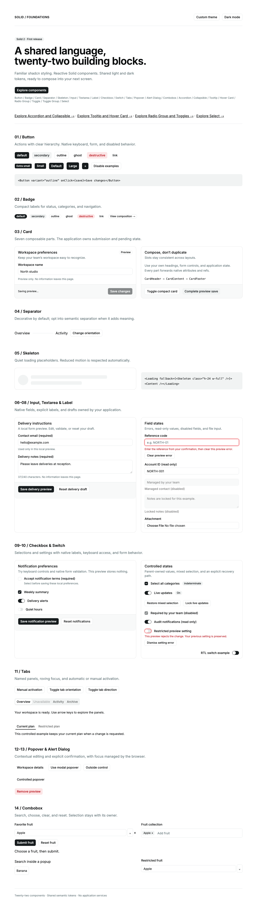
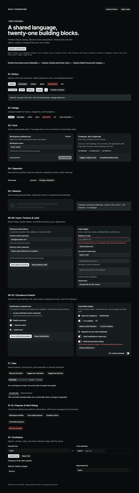

# shadcn-solidjs-theme

## Role and decisions

An owned Solid 2 design system for the future Solid admin, behind the D19 package
boundary. The implementation contains **Button, Badge, Card, Separator, Skeleton, Input,
Textarea, Label, Checkbox, Switch, Tabs, Popover, Alert Dialog, Combobox, Accordion, Collapsible, Tooltip, Hover Card, Radio Group, Toggle, Toggle Group, Select, Slider, Progress, Alert, Aspect Ratio, Attachment, Breadcrumb, Bubble, Button Group, Empty, Field, Input Group, Item, Kbd, Marker, Message, Native Select, Spinner, Table, Avatar, Pagination, Direction, Typography, Dialog, Sheet, Drawer, Dropdown Menu, Context Menu, Menubar, Navigation Menu and Command**. The React admin and Svelte storefront keep their existing themes.
See [DECISIONS.md](DECISIONS.md) for the owner's 2026-10-07 foundation direction
and [menu catalog delivery](docs/MENU-CATALOG-DELIVERY.md) for current verification status.
[FOUNDATION-DELIVERY.md](FOUNDATION-DELIVERY.md) retains the earlier five-component results.

These fifty-two components use Solid 2 and native HTML. Toggle wraps Kobalte; the
other fifty-one component families use owned behavior. Overlay and preview positioning use
`@floating-ui/dom@1.8.0`. Kobalte remains the first
candidate for richer interaction primitives. Standalone Toggle uses `@kobalte/core@2.0.0-alpha.2` behind a cancellation adapter;
see [Kobalte selection evaluation](KOBALTE-CHOICES.md). No corvu or experimental
validation patch is a production dependency.
Kobalte Checkbox/Switch were browser-tested first; reset and diagnostic failures
are recorded in [KOBALTE-TOGGLES.md](KOBALTE-TOGGLES.md).
Tooltip/Hover Card adoption evidence is in [KOBALTE-HINTS.md](KOBALTE-HINTS.md).
Accordion/Collapsible adoption evidence is in [KOBALTE-DISCLOSURES.md](KOBALTE-DISCLOSURES.md).
Progress adoption evidence is in [KOBALTE-PROGRESS.md](KOBALTE-PROGRESS.md).
Slider adoption evidence is in [KOBALTE-SLIDER.md](KOBALTE-SLIDER.md).
Select adoption evidence is in [KOBALTE-SELECT.md](KOBALTE-SELECT.md).
Combobox adoption evidence is in [KOBALTE-COMBOBOX.md](KOBALTE-COMBOBOX.md).
The Tabs/Popover/Alert Dialog probe is in [KOBALTE-OVERLAYS.md](KOBALTE-OVERLAYS.md).

## Key files

| File | Purpose |
| --- | --- |
| `src/components/ui/*.tsx` | Forty-four components and their compound parts |
| `src/lib/utils.ts` | Conditional classes and Tailwind 4 conflict resolution |
| `src/theme.css` | Shared oklch tokens, Inter, utilities and reduced motion |
| `src/index.ts` | Public library barrel |
| `playground/` | Interactive documentation using package exports |
| `tests/unit/` | Reactivity, native contracts, loading, token and class parity |
| `tests/integration/` | Source-component browser integration and axe checks |
| `tests/e2e/` | Built-library journeys and screenshot baselines |
| `validation/` | Earlier experiments; excluded from production builds/tests |

## Exports and usage

```tsx
import { Button } from 'shadcn-solidjs-theme/ui/button';
import { Badge } from 'shadcn-solidjs-theme/ui/badge';
import { Card, CardHeader, CardTitle, CardDescription,
  CardAction, CardContent, CardFooter } from 'shadcn-solidjs-theme/ui/card';
import { Separator } from 'shadcn-solidjs-theme/ui/separator';
import { Skeleton } from 'shadcn-solidjs-theme/ui/skeleton';
import { Input } from 'shadcn-solidjs-theme/ui/input';
import { Textarea } from 'shadcn-solidjs-theme/ui/textarea';
import { Label } from 'shadcn-solidjs-theme/ui/label';
import { Checkbox } from 'shadcn-solidjs-theme/ui/checkbox';
import { Switch } from 'shadcn-solidjs-theme/ui/switch';
import { Accordion, AccordionItem, AccordionTrigger, AccordionContent } from 'shadcn-solidjs-theme/ui/accordion';
import { Collapsible, CollapsibleTrigger, CollapsibleContent } from 'shadcn-solidjs-theme/ui/collapsible';
import { Tooltip, TooltipProvider, TooltipTrigger, TooltipContent } from 'shadcn-solidjs-theme/ui/tooltip';
import { HoverCard, HoverCardTrigger, HoverCardContent } from 'shadcn-solidjs-theme/ui/hover-card';
import { RadioGroup, RadioGroupItem } from 'shadcn-solidjs-theme/ui/radio-group';
import { Toggle } from 'shadcn-solidjs-theme/ui/toggle';
import { ToggleGroup, ToggleGroupItem } from 'shadcn-solidjs-theme/ui/toggle-group';
import { Select, SelectTrigger, SelectValue, SelectContent, SelectItem } from 'shadcn-solidjs-theme/ui/select';
import { Slider } from 'shadcn-solidjs-theme/ui/slider';
import { Progress } from 'shadcn-solidjs-theme/ui/progress';
import { cn } from 'shadcn-solidjs-theme/utils';
```

```css
@import 'shadcn-solidjs-theme/theme.css';
```

`ui/*` and `utils` compile from source. The package root exposes source under the
`solid` condition and built ESM otherwise. `styles.css` exposes compiled CSS.
`hooks/*` reserves the sibling package's export shape; no hooks are delivered yet.
The root build emits declarations. No application imports this package yet.

Detailed examples, every variant/size, accessibility notes and customization:
[Component guide](docs/components.md).
[Per-component acceptance matrix](docs/TEST-MATRIX.md) links requirements to tests
and tracks browser, SSR, visual and accessibility gaps. Run `bun run dev` for the live gallery.
Open `/?progress` (append `&dark`) for known/unknown work, owner updates, RTL
and an actual Loading fallback.
Open `/?slider` (append `&dark`) for single/range values, native forms,
controlled acceptance, decimal steps, RTL and vertical sliders.
Open `/?select` (append `&dark`) for single selection, native forms, controlled
acceptance, long lists and a Select inside a modal.
Open `/?choices` (append `&dark`) for native radio forms, pressed buttons,
controlled acceptance, grouped focus, RTL and inherited styles.
Open `/?hints` (append `&dark`) for hover/focus descriptions, link previews,
controlled rejection, clipping/movement and a Tooltip inside a modal.
Open `/?disclosures` (append `&dark`) for single/multiple Accordion, nested
Collapsible, draft preservation, keyboard direction and controlled rejection.
Set custom `triggerId`/`contentId` on AccordionItem or Collapsible so both sides
of the accessibility link are known during SSR.
Open `/?combobox-contracts` for focused native-form, object-result and controlled-owner
examples; [CMB-1 delivery](docs/COMBOBOX-CMB1-DELIVERY.md) records their browser acceptance.
The same page includes long-list and modal navigation examples, verified in
[CMB-2 delivery](docs/COMBOBOX-CMB2-DELIVERY.md).
Open `/?popover-placement&placement-case=scroll` for placement checks; substitute
`resize`, `motion`, `edge` or `clip` for the other focused examples.
[POP-1 delivery](docs/POPOVER-POP1-DELIVERY.md) records their browser acceptance.
Open `/?alert-dialog-focus` for Alert Dialog keyboard and nested confirmation
examples; append `&force-mounted` to keep the child mounted while closed.
[ALT-1 delivery](docs/ALERT-ALT1-DELIVERY.md) records their focus acceptance.

Open `/?skeleton-loading` (append `&dark`) for a real Solid Loading boundary,
request resolution and unmount/remount controls. [SKL-1 delivery](docs/SKELETON-LOADING-DELIVERY.md)
records late-resolution and lifecycle checks.

Open `/?card-layout` (append `&dark`) for compact/long-content Cards and vertical
Separator variants. [CRD-1/SEP-1 delivery](docs/CARD-LAYOUT-DELIVERY.md) includes
geometry checks and dedicated visual baselines.

Open `/?native-fields` for native input types, or append `&textarea` / `&labels`
for scrolling/resizing and live label examples. [INP-1/TXT-1/LBL-1 delivery](docs/NATIVE-FIELDS-DELIVERY.md)
records their acceptance scope. [Label cache refresh](docs/LABEL-REFRESH-DELIVERY.md)
closes the Firefox live-name follow-up while preserving label and editor identity.

Open `/?link-navigation` (append `&dark` or `&disabled`) for Button/Badge keyboard
navigation and disabled-anchor examples. [BTN-1/BDG-1 delivery](docs/LINKS-NAVIGATION-DELIVERY.md)
records their acceptance.

Open `/?toggle-forms` (append `&switch` or `&mixed`) for native reset cancellation,
form reassociation and disposal examples. [CHK-1/SWT-1 delivery](docs/TOGGLES-FORMS-DELIVERY.md)
records their acceptance.

Open `/?tabs-lifecycle` (or append `&manual`) for dynamic trigger and draft-lifetime
examples. [TAB-1 delivery](docs/TABS-TAB1-DELIVERY.md) records their acceptance.




## Environment and secrets

No secrets, network requests, application API, router or query cache. Components
receive props and signals. The playground's save action is explicitly a local
preview; the completion button lets tests and readers control pending state.
`THEME_PORT` changes the local documentation port (default 4399).

Use Bun 1.4.2 and Node >=22.12.0. Dependencies are exactly pinned in package.json
and the package-local bun.lock. To install this package independently without
resolving unrelated monorepo workspaces:

```sh
tools_dir=$(mktemp -d /private/tmp/solid-theme-tools.XXXXXX)
cp package.json bun.lock "$tools_dir/"
(cd "$tools_dir" && bun install --frozen-lockfile --ignore-scripts)
# Only when this package has no node_modules already:
ln -s "$tools_dir/node_modules" node_modules
```

The playground allow list resolves that node_modules link so local fonts remain
servable. A normal workspace installation can also supply dependencies; this
increment does not update the monorepo lockfile or claim its all-workspace gates.

## Commands

```sh
bun run dev                 # interactive gallery, 127.0.0.1:4399
bun run check               # TypeScript source, tools, playground and tests
bun run typecheck           # workspace-compatible alias
bun run lint                # handwritten source and tests
bun run test                # Vitest + Solid 2 testing-library + jsdom
bun run test:coverage       # 100% thresholds on all components and library helpers
bun run test:server         # server rendering without DOM globals
bun run test:hydration      # SSR node reuse, live interactions and reduced Tabs regression
bun run build               # ESM, declarations and compiled CSS
bun run test:integration    # source JSX in Chromium, Firefox and WebKit, including axe
bun run test:e2e            # fresh builds; journeys in all three browsers; Chromium visuals
bun run build:playground    # static documentation in playground-dist/
bun run parity:report       # update the remaining admin import inventory
bun run parity:admin        # strict full-admin gate; still fails for later components
```

Playwright browsers must be installed (`bunx --no-install playwright install
chromium firefox webkit`). Tests own their local server and do not reuse a running one.
On macOS the WebKit launcher enables button Tab navigation for that process only;
link tests use native Option-Tab. It does not change system/Safari preferences.
[WebKit delivery](docs/WEBKIT-DELIVERY.md) records the native differences and the
nested-modal focus fix. Use `RESULTS_FILE` to retain a browser JSON report. Visual baselines are committed
files under `tests/e2e/visual.spec.ts-snapshots`; regenerate deliberately with
`bun run test:e2e --update-snapshots=all` and review the images before accepting them.

## Agent gotchas

- Solid core/web/signals stay on **2.0.0-rc.13**. JSX imports/types come from
  `@solidjs/web`; helpers use `omit`, and props are read inside tracked JSX.
  The official [Solid 2 migration guide](https://raw.githubusercontent.com/solidjs/solid/next/documentation/solid-2.0/MIGRATION.md)
  supersedes older recipes in specs.md.
- `vite-plugin-solid@3.0.0-next.27`, testing-library `1.0.0-beta.3` and Vitest
  `4.1.10` are the verified toolchain. Newer Vitest exists; upgrades are separate
  changes. Run tests through Vitest, not `bun test`.
- Use `class`, lowercase `tabindex`, string ARIA booleans, plain `ref`, and
  `<Loading>` (Solid 2's loading boundary). Native DOM props remain reactive.
- Input and Textarea preserve native `value`/`defaultValue`, form reset, refs and
  events. Use `onInput` for live drafts, `readonly` and `maxlength` in Solid JSX,
  and connect Label `for` to the field `id`. Controlled draft reset belongs to
  the form owner; see the component guide and playground.
- Checkbox accepts `boolean | 'indeterminate'`; Switch accepts boolean and
  `size="sm" | "default"`. Both expose `onCheckedChange`, native input refs,
  label/form association and controlled rejection. Their visual wrappers are
  noninteractive; use Label `for` with the native input `id`.
- Button defaults to `type="button"`; request `type="submit"` explicitly.
  `as="a"` supports links and disabled-link behavior. Badge supports `as="a"`.
  React's `asChild` and arbitrary `as` components are not supported in this batch;
  use `buttonVariants`/`badgeVariants` with a router-owned link component.
- The React radix-nova class tables are preserved with one tested correction:
  destructive text uses `text-destructive-emphasis`, derived from destructive
  and foreground tokens for contrast. Shared `:root`/`.dark` blocks remain
  byte-identical. `tailwind-merge@3.6.0` understands the Tailwind 4 utilities.
- Separator defaults to decorative and supplies both `data-orientation` and
  `data-horizontal`/`data-vertical` hooks. Skeleton is decorative and always
  `aria-hidden`; the app supplies a loading status or `aria-busy` on its region.
- Browser tests reject all warnings/errors. Coverage measures this batch, not
  full catalog completeness. Existing primitive findings stay in validation/.
- Read AGENTS.md, DELIVERY.md and the current delivery report before extending
  the package. No registry script may overwrite the owned Solid 2 source.

Source hydration now has [node-identity and interaction regressions](docs/HYDRATION-DELIVERY.md),
including the two-tab/one-input registration reproduction and
[real Loading boundary resolution/disposal](docs/LOADING-HYDRATION-DELIVERY.md), and
[client rejection/retry with preserved drafts](docs/ERRORED-HYDRATION-DELIVERY.md).
During a pending retry, Solid 2 rc.13 can retain the previous error view until the
new promise settles. Test settlement controls must remain available independently
of that pending transaction; expecting an immediate Loading fallback can deadlock
a manually settled fixture.
The harness compiles public source exports with SSR enabled; the existing `dist` bundle is for client rendering.

The [native catalog guide](docs/components.md#native-catalog-compositions) adds sixteen
families with a focused preview at `/?catalog-native`. The full remaining catalog
continues in [the implementation ledger](docs/CATALOG-DELIVERY.md).

Open `/?catalog-modal` for Dialog, Sheet and Drawer examples in light/dark modes.
