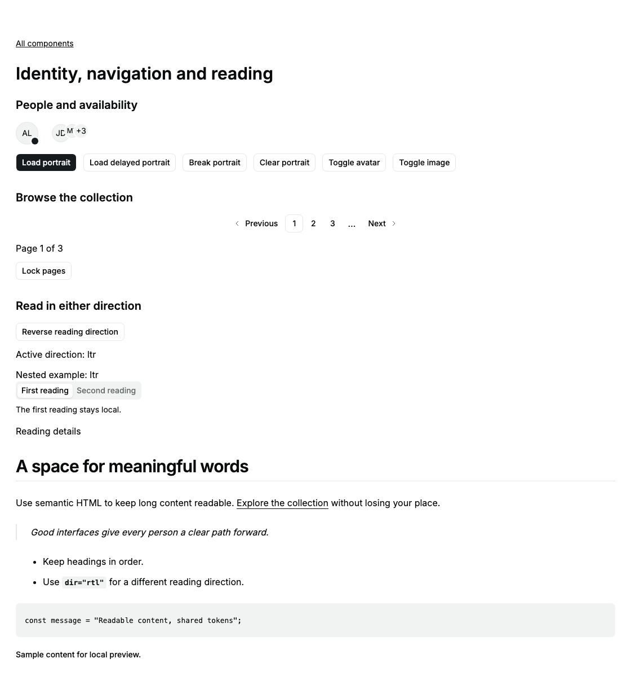
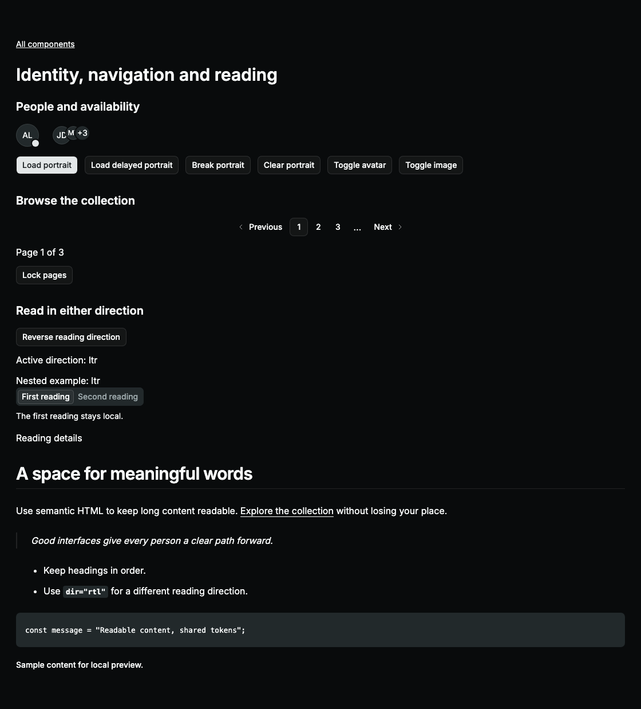
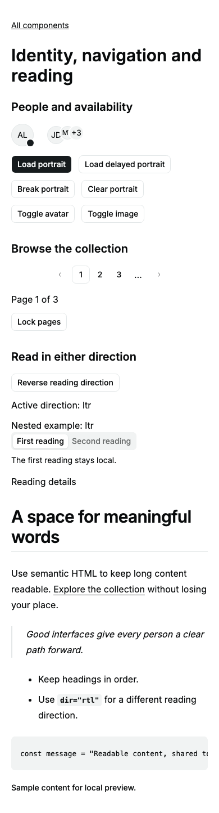

# Display catalog delivery

Adds Avatar, Pagination, Direction and Typography under the full catalog request.
The remaining families stay tracked in [CATALOG-DELIVERY.md](CATALOG-DELIVERY.md).

## Kobalte first

`@kobalte/core@2.0.0-alpha.2` Image passes real load/failure/recovery/unmount in
Chromium and Firefox but emits an Image.Img status-relay diagnostic under rc.13.
The [unpatched probe](../validation/solid2-avatar/README.md) preserves raw results.
Owned Avatar synchronizes a browser Image, directly updates shared status and
ignores stale callbacks; dependencies are unpatched and diagnostics unsuppressed.

Published Pagination owns page/count generation and button-based rows. The
sibling API is passive native link composition, so owned native wrappers preserve
that contract. This is a source/API choice, not a runtime incompatibility claim.
Kobalte I18n direction is locale-derived; explicit nested direction is an owned
context plus real native div. Typography needs semantic HTML/CSS, not a headless
engine. No new dependency, corvu fallback or runtime pin change.

The current upstream [Typography entry](https://ui.shadcn.com/docs/typeset)
redirects to Typeset. These semantic recipes do not claim its full CSS API.

## Acceptance criteria

| DELIVERY criterion | Evidence and limits |
| --- | --- |
| State ownership | Host owns image source, navigation and explicit direction. Avatar owns only decode status; context values are derived. |
| Usable states | Missing/loading/loaded/failed image and fallback; disabled page bounds; direction inheritance. |
| Recovery | New valid source retries after image failure. Pagination never owns or discards host drafts. |
| Async consistency | Source changes deactivate previous decode handlers; pending completion after root disposal cannot update the new owner. |
| Platform boundaries | No application service, desktop API, IPC or backend work; these are library components. |
| Reactivity/cleanup | Scoped preload callbacks and fallback timer disposed; direct state updates avoid relayed derived state. |
| Keyboard/accessibility | Native links with current/disabled state, semantic headings, named badge/count, focusable preformatted region; dynamic Tabs RTL and Popover alignment; light/dark axe. Manual screen readers unrun. |
| Customization | Shared tokens/sibling classes, logical arrows/padding, light/dark/mobile screenshots and enlarged text. |
| Structure/performance | Small composition wrappers, no page engine or Markdown parser. Whole-library size measured after build; no performance benchmark claim. |
| Tests | Unit, source browser, server, hydration, built E2E and visual gates recorded below. |
| Evidence | Per-family limits remain explicit in [TEST-MATRIX.md](TEST-MATRIX.md); no blanket coverage claim from execution percentages. |

Browser verification caught lost link roles on disabled anchors and incorrect
inline RTL layout under `display: contents`; Pagination now preserves link role
and DirectionProvider uses a real block boundary. Accessible examples give badge
icons a role and code overflow keyboard access. Unit misuse checks use a Solid
Errored boundary, preserving strict diagnostic assertions.

## Verification

All eight gates passed. [Command evidence](evidence/catalog-display-commands.json), [complete log](evidence/catalog-display-verification.txt), [self-review](evidence/catalog-display-self-review.json).

| Command | Result | Time |
| --- | --- | ---: |
| `bun run check` | Passed | 3.62 s |
| `bun run lint` | Passed | 1.9 s |
| `bun run test --maxWorkers=2` | Passed | 8.37 s |
| `bun run test:coverage --maxWorkers=2` | Passed | 9.33 s |
| `bun run test:server` | Passed | 0.98 s |
| `RESULTS_FILE=docs/evidence/catalog-display-hydration.json bun run test:hydration --max-failures=1` | Passed | 65.53 s |
| `THEME_PORT=4403 RESULTS_FILE=docs/evidence/catalog-display-integration.json bun run test:integration --grep "Avatar \|Pagination \|Direction \|Display catalog" --max-failures=1` | Passed | 19.57 s |
| `THEME_PORT=4403 RESULTS_FILE=docs/evidence/catalog-display-e2e.json bun run test:e2e --grep "Avatar \|Pagination \|Direction \|Display catalog" --max-failures=1` | Passed | 20.11 s |

Self-review added a reactive callback regression after the full suite. Avatar status notifications now take an intentional untracked snapshot of the latest handler, without restarting image decoding. Core gates and full hydration ran again; browser reruns target the affected families and their visual baselines. Full prior reports remain in `evidence/catalog-display-before-callback-*`. No other production change followed the full regression.

Package-wide totals: 213 unit tests; 100% included-source execution coverage; 15 grouped SSR tests; 105 hydration runs; full regression of 417 source integration runs and 399 built E2E runs before the isolated callback repair; final affected-component rerun of 18 source and 21 built/visual checks; 39 image baselines. Every browser report has zero skipped, flaky or unexpected results and empty diagnostic attachments.

Whole-library JS: 196418 bytes (45783 gzip), from 185358 / 43468 gzip at `d98a804`. This excludes CSS/fonts/external Solid and is not an application transfer measurement.

