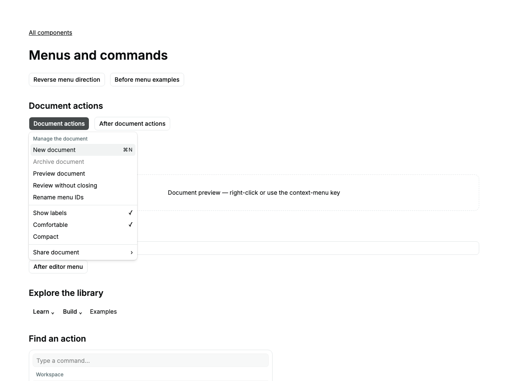
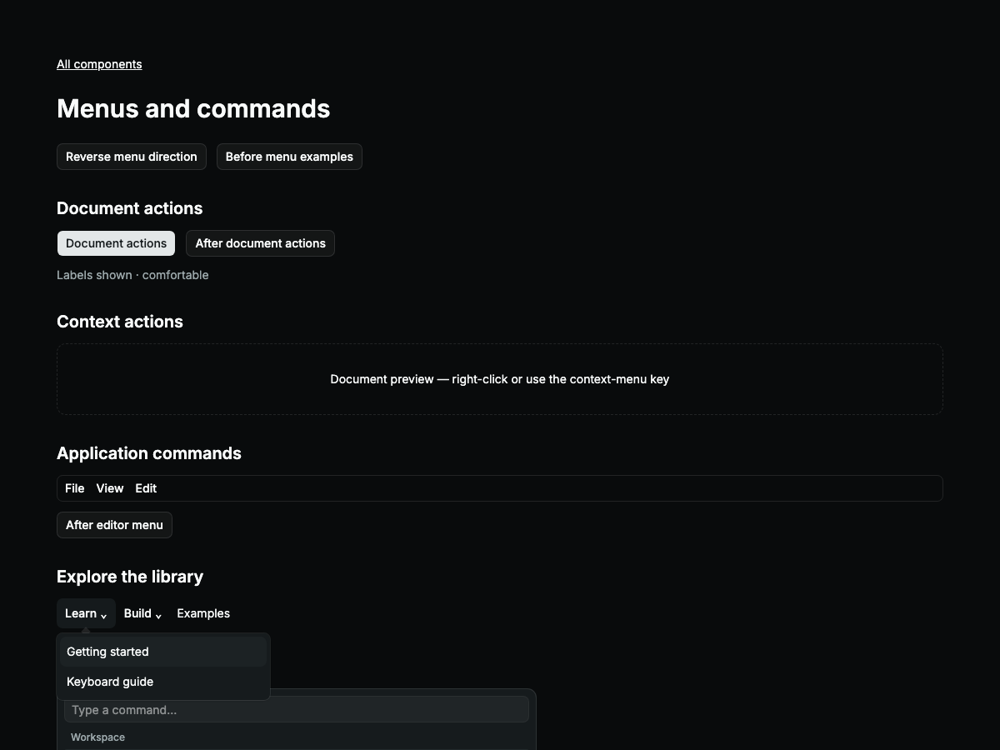
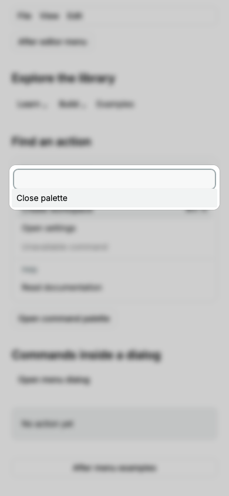

# Menu catalog delivery

Dropdown Menu, Context Menu, Menubar, Navigation Menu and Command are one group
in the continuing [full catalog task](CATALOG-DELIVERY.md).

## Library evaluation

The [unpatched Kobalte harness](../validation/solid2-menus/README.md) evaluates
alpha.2 with Solid/web/signals rc.13 in Chromium and Firefox. All four menu
primitives open, Escape-close and unmount, but Dropdown/Context/Menubar emit three
ownership/relay diagnostics each; Navigation emits seven. This is a runtime
acceptance failure, not a missing API. Command has no cmdk equivalent; the closest
Kobalte candidates retain the [Combobox evaluation](../KOBALTE-COMBOBOX.md).
Owned native menus and a command collection avoid private dependency patches.
No corvu dependency, version change or diagnostic suppression was introduced.

## DELIVERY dispositions

| Criterion | Evidence and boundaries |
| --- | --- |
| State ownership | Controlled/uncontrolled visibility and menu preferences; command query and selected value are separate. Actions and persistence belong to consumers. |
| Usable states | Open/closed, disabled, checked/mixed/radio, canceled selection, empty search, keyboard and pointer submenu entry. |
| Recovery | Canceled selection leaves the menu open; controlled rejection retains the accepted value. No transport mutation or automatic retry is supplied. |
| Async consistency | Placement ignores superseded promises and results after disposal; hover timers cancel on departure and teardown. |
| Platform boundaries | No application API, desktop adapter or IPC in this library group. |
| Reactivity/cleanup | Native popover, document listeners, positioning observer, hover timers and collection registrations follow owner lifetimes. Strict diagnostics remain enabled. |
| Keyboard/access | Menu arrows/Home/End/typeahead, disabled skipping, nested Escape, Tab departure; semantic navigation links; Command active descendant and named dialog. Automated axe in enlarged mobile light/dark. Manual screen readers unrun. |
| Customization | Existing semantic tokens and caller classes; top-layer menus keep DOM theme ancestry. Command uses natural height to avoid enlarged-text overlap. Visual results recorded below. |
| Structure/performance | Shared menu owner and positioning; separate site navigation and command semantics. No frame-rate or large-collection performance claim. |
| Tests | Units and browser tests cover ownership, selection, navigation, teardown and canceled work; server/hydration/build gates recorded below. Electron does not apply to this package. |
| Evidence | TEST-MATRIX maps assertions to families; Kobalte raw probe and complete acceptance reports are retained. |

## Explicit API limits

Menus are nonmodal native popovers; Portal retains DOM ancestry. Content is
unmounted by default, or retained with forceMount. No arbitrary asChild cloning,
exit-presence engine or global accelerator registration. MenuItem supports native
button or anchor; href is removed while disabled. Context targets preserve native
context behavior when disabled. Menubar is horizontal. Submenus use delayed mouse
intent and directional keys, without a polygon-based pointer grace area.

Navigation Menu supplies its shared viewport automatically; viewport=false renders
content beside each trigger. It uses native links and disclosures, not application
menu roles. Command requires explicit stable values, filters by value/keywords or
custom positive scores, and preserves authored order. It does not rank scores,
fetch results or implement virtualized lists. Hosts supply loading/error feedback
and decide whether selection closes CommandDialog.

WebKit's outside-button click leaves native focus on body even without a menu.
An isolated comparison confirmed identical behavior before and after dismissal;
the cross-browser assertion requires that the menu does not steal focus back,
with separate checks for native Tab/Shift+Tab and usable subsequent input focus.

## Verification

All eight gates passed. [Commands](evidence/catalog-menus-commands.json), [complete log](evidence/catalog-menus-verification.txt), [self-review](evidence/catalog-menus-self-review.json).

| Command | Result | Time |
| --- | --- | ---: |
| `bun run check` | Passed | 3.65 s |
| `bun run lint` | Passed | 1.65 s |
| `bun run test --maxWorkers=2` | Passed | 9.22 s |
| `bun run test:coverage --maxWorkers=2` | Passed | 10.84 s |
| `bun run test:server` | Passed | 1.09 s |
| `RESULTS_FILE=docs/evidence/catalog-menus-hydration.json bun run test:hydration --max-failures=1` | Passed | 72.43 s |
| `THEME_PORT=4403 RESULTS_FILE=docs/evidence/catalog-menus-integration.json bun run test:integration --max-failures=1` | Passed | 408.7 s |
| `THEME_PORT=4403 RESULTS_FILE=docs/evidence/catalog-menus-e2e.json bun run test:e2e --max-failures=1` | Passed | 300.34 s |

Package-wide totals: 258 units; 100% statements, branches, functions and lines; 17 grouped SSR tests; 111 hydration runs; 480 source integration runs; 468 built E2E/visual runs; 66 image baselines. No skipped, flaky or unexpected browser tests; no diagnostics.

Whole-library JS: 249817 bytes (57450 gzip), from 213734 / 49747 gzip at `57cc3dc`. No application transfer-size claim.

