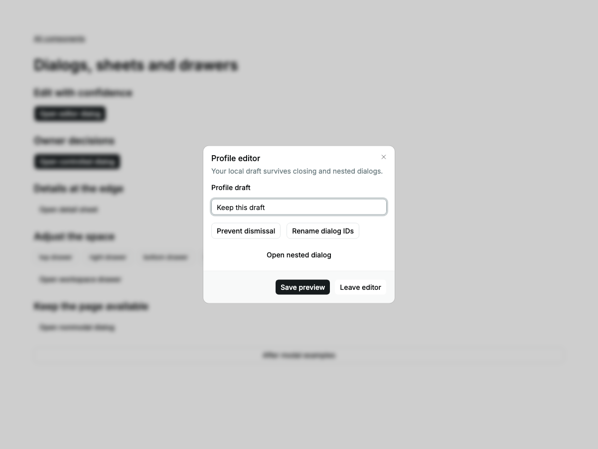
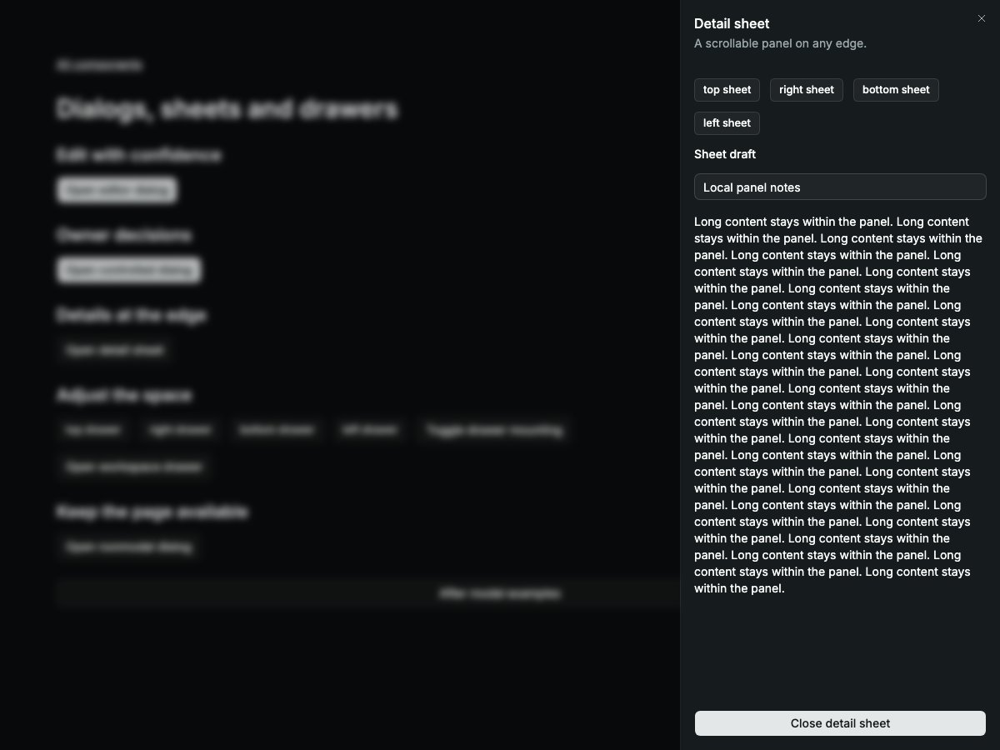
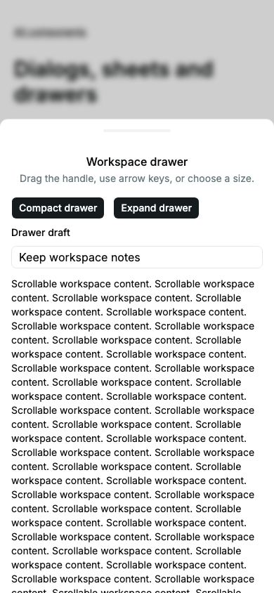

# Modal catalog delivery

Dialog, Sheet and Drawer extend the native layer lifecycle already used by Alert
Dialog. This is one group within the full [catalog task](CATALOG-DELIVERY.md).

## Kobalte first

The pinned `@kobalte/core@2.0.0-alpha.2` has both Dialog and Drawer, including
Drawer gestures and snap points. Earlier unpatched probes and isolated repairs
are retained in [KOBALTE-LIFECYCLE.md](validation/KOBALTE-LIFECYCLE.md),
[KOBALTE-PRESENCE.md](validation/KOBALTE-PRESENCE.md) and
[KOBALTE-DIALOG-IDS.md](validation/KOBALTE-DIALOG-IDS.md). Those owner/registration,
presence and ID failures have not become a production-accepted upstream release.
This group reuses that evaluation at the unchanged pins, rather than claiming a
new Kobalte run. Sheet is dialog presentation. Owned native shells avoid private
dependency patches; no corvu, dependency upgrade or warning filter is introduced.

## Acceptance criteria

| DELIVERY criterion | Evidence and limits |
| --- | --- |
| State ownership | Root owns open state unless controlled; host owns drafts, requests and persistence. Drawer derives geometry from measured extent and snap selection. |
| Usable states | Closed/open, retained or unmounted content, canceled dismissal, controlled rejection, four physical sides, bounded long-content scrolling. |
| Recovery | Example save failure keeps the draft, explicit retry clears the failure; rejected controlled close leaves the panel open. No backend mutation is simulated as successful. |
| Async consistency | No data transport. Shared native layer guards delayed native close events; observer lifetime follows the open Drawer. |
| Platform boundaries | Library-only work: no AppApi, desktop adapter, IPC or application services apply. |
| Reactivity/cleanup | Shared layer restores focus and scroll locks; Drawer releases ResizeObserver and pointer gesture ownership. Strict browser diagnostics remain enabled. |
| Keyboard/accessibility | Dialog names/descriptions and dynamic IDs, modal Tab containment, Escape, nested focus return, native nonmodal interaction; Drawer handle supports directional arrows/Home/End. Light/dark enlarged mobile axe checks. Manual screen readers unrun. |
| Customization | Sibling classes and unchanged tokens; nine light/dark/mobile images visually reviewed. Panel scrolling verified; four sides have browser geometry assertions. |
| Structure/performance | One shared modal lifecycle, presentation wrappers and Drawer gesture owner. Whole-library build size measured; no frame-rate or latency claim. |
| Tests | Unit, source browser, SSR, hydration, built E2E and screenshot comparison. Final gates recorded below. Electron/admin application tests do not apply to this library scope. |
| Evidence | Per-family assertions and limits in TEST-MATRIX; exact commands and timings below. |

Hydration initially failed at the shell's nested conditional `popover` getter.
The generated client included an additional memo under a different hydration
owner order. Moving this calculation into a plain accessor eliminated the
observed mismatch across all three engines, with server node identity retained.
The [failing report](evidence/catalog-modal-hydration-before.json) is retained.
This does not establish a general compiler fix or justify suppressing diagnostics.

## API boundaries

Portal preserves theme and direction ancestry; the browser top layer provides
visual escape rather than moving DOM to body. Content supplies its own overlay.
Native nonmodal light-dismiss is browser-owned; modal outside hooks are cancelable.
There is no delayed exit-animation retention or arbitrary `asChild` cloning.
Drawer dragging starts on the dedicated handle, leaving content gestures native.
Numeric snap points are fractions of the full panel (80dvh by default vertically),
not Vaul viewport fractions; pixel strings are also supported. Snaps are bounded
by the panel and measured handle. No velocity/momentum, background scaling or
arbitrary content swipe is claimed. Real mobile touch/virtual keyboard testing
and dynamic modality changes while open remain unverified.

## Verification

All eight gates passed. [Commands](evidence/catalog-modal-commands.json), [complete log](evidence/catalog-modal-verification.txt), [self-review](evidence/catalog-modal-self-review.json).

| Command | Result | Time |
| --- | --- | ---: |
| `bun run check` | Passed | 3.52 s |
| `bun run lint` | Passed | 1.65 s |
| `bun run test --maxWorkers=2` | Passed | 8.39 s |
| `bun run test:coverage --maxWorkers=2` | Passed | 9.73 s |
| `bun run test:server` | Passed | 1.0 s |
| `RESULTS_FILE=docs/evidence/catalog-modal-hydration.json bun run test:hydration --max-failures=1` | Passed | 70.55 s |
| `THEME_PORT=4403 RESULTS_FILE=docs/evidence/catalog-modal-integration.json bun run test:integration --max-failures=1` | Passed | 372.17 s |
| `THEME_PORT=4403 RESULTS_FILE=docs/evidence/catalog-modal-e2e.json bun run test:e2e --max-failures=1` | Passed | 271.73 s |

The first full source regression stopped at an existing WebKit Tabs diagnostic:
panel visibility recomputed for unrelated registration writes. This blocked the
required gate. A panel-local memo now publishes visibility changes rather than exposing
the full registry to Show. An earlier root-level memo was rejected because it
snapshotted empty server metadata before trigger registration. The raw failure is retained in
`evidence/catalog-modal-integration-before.json`; no warning filter or time delay
was added. Self-review also added a force-mounted close-mid-drag regression and
clears the Drawer drag offset when its observer scope ends.

A later source run exposed an independent Slider collection recomputation warning
in Firefox. Thumb iteration now depends on stable count-derived indices; value
changes update each thumb's bindings without rebuilding the collection. The
existing keyboard/form scenario passed three fresh Firefox repetitions. The raw
failure is retained in `evidence/catalog-modal-integration-before-slider.json`.
These small existing-component changes were necessary to pass the required gate.

Package-wide totals: 229 unit tests; 100% statements, branches, functions and lines; 16 grouped SSR tests; 108 hydration runs; 447 source integration runs; 432 built E2E/visual runs; 48 image baselines. Browser reports contain no skipped, flaky or unexpected tests and no diagnostics.

Whole-library JS: 213734 bytes (49747 gzip), from 196418 / 45783 gzip at `5f677df`. No application transfer-size claim.

