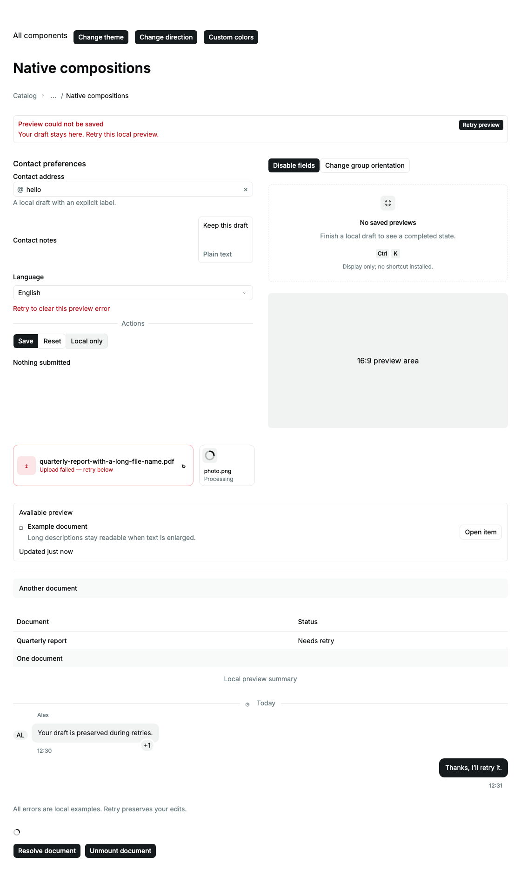
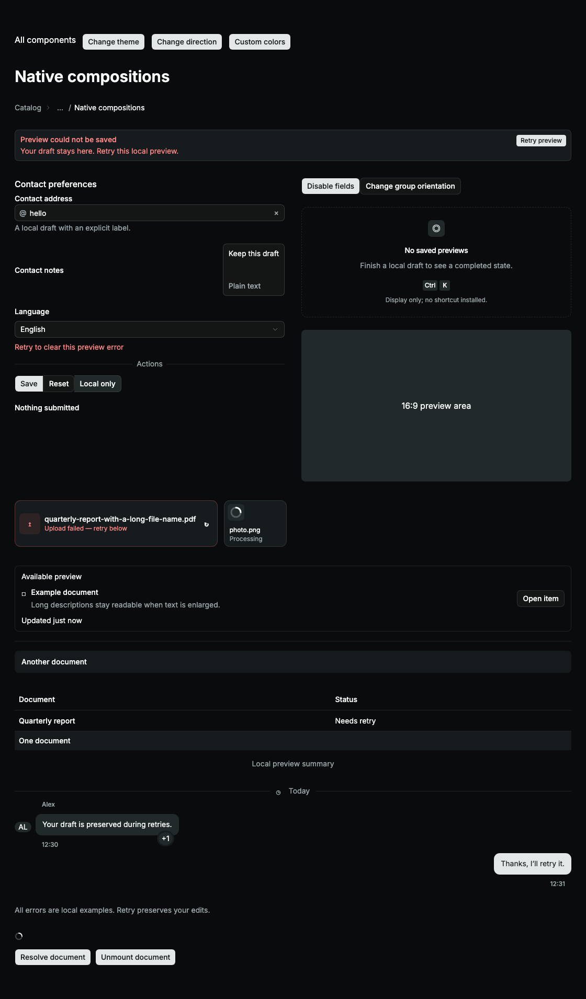
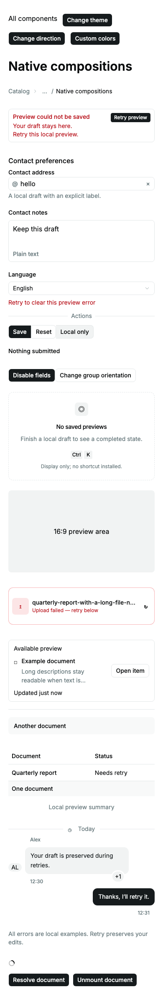

# Native catalog delivery

Adds sixteen families to the Solid 2 catalog: Alert, Aspect Ratio, Attachment,
Breadcrumb, Bubble, Button Group, Empty, Field, Input Group, Item, Kbd, Marker,
Message, Native Select, Spinner and Table. The complete remaining-catalog task
stays open in [CATALOG-DELIVERY.md](CATALOG-DELIVERY.md).

## Library evaluation and implementation

Evaluated the published `@kobalte/core@2.0.0-alpha.2` source first:
`dist/alert/CzeMAQh2.jsx` renders a polymorphic div with `role=alert`;
`dist/breadcrumbs/QLc6QCFL.jsx` supplies a nav label, current-link state and a
hidden separator. Both capabilities can be expressed directly in the native
HTML required by the sibling API. These are owned semantic wrappers; this is a
source/API selection, **not a claim that Kobalte fails either primitive**.
Kobalte TextField is not a generic Field provider for mixed control families;
Button, Label and Separator compositions reuse the already delivered package
primitives. No corresponding Kobalte engine is needed for the other presentation
families. No corvu or other dependency was added, and no runtime pin changed.

Ports the local React sibling's radix-nova classes and exports. Solid accepts
`class`, native event handlers and refs; supported native polymorphism uses `as`
instead of cloning children. Preserves explicit slots through Button, Input,
Textarea, Label and Separator so their new compound parts receive the correct
styling. No component owns upload transport, validation policy, shortcuts,
message storage or application requests.

The browser checks found and fixed light-theme keyboard-label contrast, RTL
alert-action positioning and implicit minimum grid widths with enlarged text.
Kbd uses semantic foreground rather than muted foreground. Destructive text
uses the package's existing contrast-corrected semantic token. Examples choose
matching custom primary colors for each theme. Canonical theme tokens are
unchanged. Geometry assertions check both left and right bounds: RTL overflow
can escape a document scroll-width assertion.

## Acceptance criteria

| DELIVERY.md criterion | Disposition |
| --- | --- |
| State ownership | Examples own drafts, error recovery, direction and submit results. Components derive slots and variants from props. |
| Usable states | Empty and processing examples, disabled fieldset, failed attachment with working retry, ready state and named status. Transport stays with the host. |
| Recovery | Local retries clear errors and preserve edited fields; duplicate messages collapse; recovered FieldError unmounts. |
| Async consistency | No new requests, subscriptions or timers. Spinner displays host pending state; actual Loading resolution, pending unmount and late completion are exercised for Spinner. |
| Platform boundaries | Package has no service/desktop/IPC integration. Not applicable to native presentation wrappers. |
| Reactivity and cleanup | Signal-driven variants and messages, native DOM events, disposal by Solid. No new external lifecycle resources. |
| Keyboard and assistive access | Native labels/forms/links/buttons, table headers/caption, hidden breadcrumb decoration, named loading status, reduced motion and axe in both themes. Manual screen readers remain unrun. |
| Customization | Sibling classes, semantic tokens, caller classes, light/dark/mobile screenshots and enlarged RTL bounds. |
| Structure/performance | Small wrappers and derived error messages; no performance benchmark claim. Whole-library size measured below; no dependency added. |
| Tests | Unit, source browser, SSR, hydration and built E2E; final command evidence below. |
| Accurate evidence | Exact commands, durations and final results are recorded below; historical failing probes do not count as passes. |

## Commands

All eight required gates passed on the final implementation. Full output and machine-readable results are saved in [command evidence](evidence/catalog-native-commands.json) and [verification log](evidence/catalog-native-verification.txt).

| Command | Result | Time |
| --- | --- | ---: |
| `bun run check` | Passed | 3.07 s |
| `bun run lint` | Passed | 1.38 s |
| `bun run test --maxWorkers=2` | Passed | 7.4 s |
| `bun run test:coverage --maxWorkers=2` | Passed | 8.38 s |
| `bun run test:server` | Passed | 0.88 s |
| `RESULTS_FILE=docs/evidence/catalog-native-hydration.json bun run test:hydration --max-failures=1` | Passed | 61.08 s |
| `THEME_PORT=4403 RESULTS_FILE=docs/evidence/catalog-native-integration.json bun run test:integration --max-failures=1` | Passed | 351.2 s |
| `THEME_PORT=4403 RESULTS_FILE=docs/evidence/catalog-native-e2e.json bun run test:e2e --max-failures=1` | Passed | 237.48 s |

The initial broad hydration run was interrupted after identifying the Dynamic
optional-type regression. Its results are not included in the final pass counts.
The subsequent focused three-engine check passed; all gates run again on the fix.

## Hydration correction

The broad run found a regression introduced after the first focused pass:
an optional JSX `type` attribute on div-rendering Dynamic parts consumed
different server/client hydration IDs. Using a conditional prop spread only
when the part renders a button restores node claiming in the three-engine
focused check. All 102 full hydration checks passed after this correction; no
diagnostics are suppressed and dependency code is unchanged.

## Reviewed screenshots

## Counts, size and review

204 unit tests; 100% included-source statements, branches, functions and lines; 14 grouped SSR tests; 102 hydration checks; 399 source-browser checks; 378 built E2E checks. All browser reports have zero skipped, flaky or unexpected results, and empty diagnostic attachments. These package-wide counts do not prove exhaustive per-family behavior. See [TEST-MATRIX.md](TEST-MATRIX.md) for explicit limits.

Whole-library JavaScript: 185358 bytes (43468 gzip), a delta of 41962 bytes (7240 gzip) from `792e003`. This excludes CSS, fonts and the external Solid runtime and is not application transfer size. [Size evidence](evidence/catalog-native-size.json).

Reviewed all new source and tests, the complete tracked diff, and eight changed screenshots. The documentation copies exactly match their baselines; 36 baselines exist. No dependency, shared-token, backend, secret or CI changes. [Self-review evidence](evidence/catalog-native-self-review.json).
