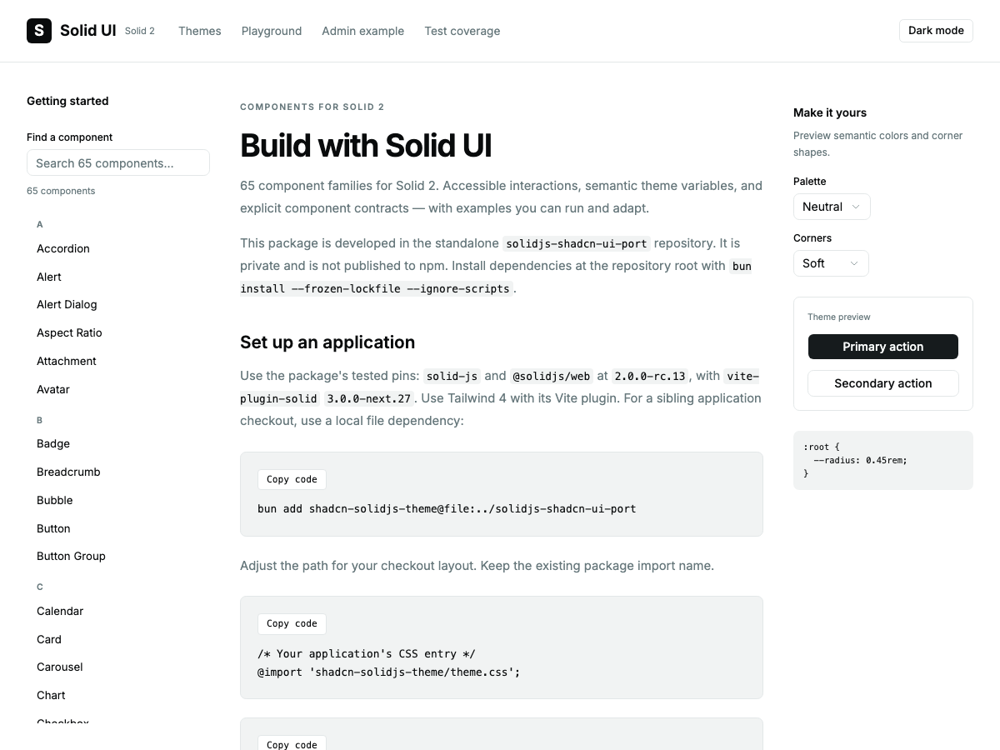

# Solid library delivery — 2026-10-09

The package implements the dated 65-family catalog. This final increment adds a
searchable documentation website, closes missing guide examples, measures real
consumer imports and verifies the selected router/query stack in isolation.
The original package scope excludes rewriting the React admin application.

## Documentation website

Open `/docs.html` on the playground server. All 65 families have searchable,
directly addressable pages, copyable examples, existing screenshots and a live
preview link. Getting started, theme variables, the admin composition and measured
acceptance records are available from the same website. Browser history uses
ordinary URLs; a failed page load retains the shell/theme and provides Retry.

Bun 1.4.2 compiles maintained Markdown at build time through
[Bun.markdown](https://bun.com/docs/runtime/markdown). There is no new dependency
or Markdown parser in the component library/browser. Raw HTML is escaped and
executable URL schemes are removed. Package-local screenshots, source examples
and evidence are copied into generated static assets; repository-only references
are labeled rather than exposed as broken website links. The generator excludes
AGENTS.md from both pages and asset downloads. Generation clears its own output
first so removed pages cannot remain in a later build; the inventory test creates
a stale page and verifies its removal. Generated content stays untracked and is
rebuilt by dev/build commands.

Navigation uses stable links grouped by alphabet. A single 65-link reactive owner
exceeded the development time/dependency budgets; group owners and hiding matches
avoid recreating links on every search. [Initial finding](evidence/docs-site-search-before.json).
Strict diagnostics remain enabled. A WebKit radius assertion compares the numeric
computed value, avoiding a false failure from its `19.200001px` serialization.
The guide now also includes typechecked usage
for seven guide compositions, including native/display parts, modal overlays,
menus, date inputs, layout and notifications. A unit inventory requires every
family to demonstrate its own exported JSX API, with images and a valid preview target.

The reviewed desktop, dark, narrow and custom-theme baselines live with the
[website visual tests](../tests/e2e/docs-site/visual.spec.ts). The production suite
compares them without regenerating snapshots.

## Consumer costs and chart correction

The size probe retains actual public component functions in minified production
bundles with Solid and dependencies included. It measures source imports and the
built root separately. CSS, fonts and app data are excluded; these are reproducible
sample costs, not every application's final size.

Importing Button from the built root formerly retained eager `chart.js/auto`
registration. Chart now registers its engine on its first mounted canvas and reuses
that registration. Merely importing unrelated parts or server-rendering does not
register charts. Existing canvas cleanup and chart APIs are unchanged.

[Before measurements](evidence/consumer-bundles-before.json) and
[current measurements](evidence/consumer-bundles.json) preserve module inventories.

| Consumer | Source gzip | Built-root gzip before | Built-root gzip after |
| --- | ---: | ---: | ---: |
| Button | 28,578 B | 104,883 B | 58,376 B |
| Form controls | 30,702 B | 106,983 B | 60,449 B |
| Dialog and Select | 42,904 B | 118,459 B | 71,960 B |
| Data Table | 56,576 B | 132,387 B | 85,855 B |
| Chart | 98,953 B | 106,406 B | 106,422 B |

Source subpaths remain the recommended imports: root bundling still retains more
shared initialization. Registration is covered by a direct regression; actual
charts retain browser, hydration and visual acceptance.

## Scrollable menu correction

The final source checks exposed a keyboard accessibility defect when placement
constrained a dropdown enough to scroll. Every item had a negative tab index,
including the focused item, so the scrollable region had no native tab stop.
MenuItem now exposes only the focused, enabled item at tab index zero, clears it
on blur and forwards the caller's focus/blur handlers. Native Tab and Shift-Tab
still leave the menu; arrow keys still scroll and focus items.

A constrained-height browser regression proves overflow, one tab stop, arrow
movement, scrolling, axe acceptance and natural Tab departure. A unit regression
checks focus ownership, forwarded callbacks and disabling a focused item. The
[deterministic failing case](evidence/menu-scroll-regression-before.json),
[original full-suite finding](evidence/completion-menu-before.json) and
[focused menu acceptance](evidence/menu-scroll-regression-after.json) are retained.

## Controlled-value equality correction

WebKit also exposed a repeated-computation diagnostic while typing into the admin
form. `createControllable` returned a plain accessor, which let draft-object
changes reach every downstream modal consumer even when the derived open boolean
remained true. It now memoizes the effective controlled/local value. The regression
observes subscriber notifications across unrelated draft edits, controlled rejection
and switching back to local ownership. No timing budget or warning was disabled.
[Original diagnostic](evidence/completion-controlled-before.json) and
[focused admin verification](evidence/controlled-admin-after.json).

## Consumer stack

[The isolated harness](../validation/consumer-stack/README.md) verifies Router
next.36 and Query rc.5 with Solid rc.13: real Loading, cached navigation, retained
form drafts, pending Tabs and query-backed Dialog content. The request-count
assertion distinguishes cancellation/restart from cached modal reopening.
Newer Router next.37/38
require rc.14, so they are not adopted. Runtime/library pins remain unchanged.

## Verification

| Command | Result | Time |
| --- | --- | ---: |
| `node scripts/check-consumer.mjs` | Passed | 1.271 s |
| `bun run test:server` | 26 passed | 1.324 s |
| `bun run test:coverage --coverage.reporter=json-summary --coverage.reporter=text --maxWorkers=2` | 394 passed; 100% statements, branches, functions and lines | 21.052 s |
| `THEME_PORT=4403 RESULTS_FILE=docs/evidence/completion-consumer.json bun run test:consumer --max-failures=1` | 9 passed | 10.203 s |
| `THEME_PORT=4403 RESULTS_FILE=docs/evidence/completion-hydration.json bun run test:hydration --max-failures=1` | 135 passed | 118.695 s |
| `THEME_PORT=4403 RESULTS_FILE=docs/evidence/completion-integration.json bun run test:integration --max-failures=1` | 651 passed | 652.217 s |
| `bun run check` | Passed | 4.563 s |
| `bun run lint` | Passed | 2.044 s |
| `bun run docs:check` | 7 guide compositions typechecked | 2.300 s |
| `bun run test` | 394 passed | 7.997 s |
| `THEME_PORT=4403 THEME_PRODUCTION=1 RESULTS_FILE=docs/evidence/completion-firefox-load-after.json bunx playwright test tests/e2e/docs-site.spec.ts --project=firefox --repeat-each=3 --max-failures=1` | 18 passed across three repetitions | 29.916 s |
| `THEME_PORT=4403 RESULTS_FILE=docs/evidence/completion-docs-focused.json bunx playwright test tests/integration/docs-site.spec.ts --max-failures=1` | 18 passed | 23.622 s |
| `THEME_PORT=4403 RESULTS_FILE=docs/evidence/completion-e2e.json bun run test:e2e --max-failures=1` | Builds passed; 667 passed, including screenshot comparisons | 499.538 s |
| `node scripts/measure-consumer-bundles.mjs` | 10 measured source/built cases | 1.162 s |
| `bun pm pack --dry-run --ignore-scripts` | 170 files; no archive published | 0.050 s |
| `bunx vitest run tests/unit/docs-site.test.ts` | 2 passed against finalized documentation | 2.108 s |

The full browser suites cover Chromium, Firefox and WebKit with one worker,
no retries and unchanged diagnostic budgets. The repeated navigation probe uses
Firefox only; visual comparisons run in Chromium. Hydration
includes three intentional unsafe-pattern characterization cases; those passing
negative controls are not claims that the unsafe pattern works. Unit coverage
measures package source, not exhaustive UI behavior or the documentation generator.

[Exact commands and output](evidence/library-completion-commands.json),
[final documentation inventory](evidence/completion-final-docs.json),
[unit coverage](evidence/completion-coverage.json),
[consumer](evidence/completion-consumer.json),
[hydration](evidence/completion-hydration.json),
[source browser](evidence/completion-integration.json), and
[built browser](evidence/completion-e2e.json) evidence are retained.

The first full unit run identified an outdated hydration mock for `chart.js/auto`.
It now mocks the actual named Chart export and asserts registration and disposal;
[the initial failure](evidence/library-completion-first-commands.json) is retained.
The first full source-browser run stopped on the new skip-link test: macOS
WebKit skips native links with Tab. The test now uses the same Option-Tab gesture
as the existing native-link suite and waits for the new page before keyboard input.
[That first result](evidence/completion-integration-before.json) is retained; no
application focus handler or browser preference was changed.
A subsequent source run captured an unrelated Carousel orientation update at
16 ms against the 8 ms development budget. Five isolated Firefox reproductions
passed with the same budgets and assertions; captured attribution costs show at
most 3 ms summed self-time for any scope across each complete journey, with 62
re-runs per journey. No runaway update or repeatable expensive derivation was
found. The cause of the single timing outlier remains unestablished; the gate was
not relaxed and no speculative Carousel change was made. See the
[original finding](evidence/completion-carousel-before.json),
[five cost captures](evidence/carousel-cost-probe.json) and
[temporary probe source](evidence/carousel-cost-probe-source.txt).

The first production run stopped on Firefox’s layout-before-load warning during
Playwright’s injected inspection immediately after a native documentation link
navigation. The trace showed the destination body still empty. Website tests now
start a load-event wait before the native click and disable only the click’s
intermediate navigation wait, preventing a trace snapshot of the partially loaded
destination. A wait added after the click was too late; that
[failed attempt](evidence/completion-firefox-load-wait.json) is retained.
Diagnostics and trace capture remain enabled. [Initial result](evidence/completion-firefox-load-before.json) and
[three repeated Firefox journeys](evidence/completion-firefox-load-after.json).

Badge also has a dedicated server-rendering assertion for all six variants,
forwarded class/label attributes, span semantics and native links.

The initial, pre-license [package dry run](evidence/completion-pack.json) contains 170 files (1.73 MB
unpacked): source, build output, manifest and README only. It excludes generated
website assets, test harnesses and local configuration. Nothing was published.

## DELIVERY checklist

| Criterion | Evidence and scope |
| --- | --- |
| State ownership | Website theme/search/page requests are independent; the consumer QueryClient owns caching and Solid owns async rendering. |
| Usable states | Documentation loading, unknown page, malformed response, recovery and no search results; real query Loading and pending tabs. |
| Recovery | Explicit website retry retains settings; native navigation and cached remount preserve the shell draft. No mutation retry added. |
| Async consistency | Documentation requests abort on replacement/disposal and ignore late results; query cancellation and pending modal disposal are exercised. |
| Platform boundaries | No backend or desktop access; router/query dependencies are isolated from the library. |
| Reactivity and cleanup | Navigation groups bound list work; stable links survive search; chart registration is deferred to mounted use, existing engines dispose; controlled values gate unchanged owner updates. |
| Keyboard and access | Native links/history, skip link, searchable navigation, accessible code regions, copy feedback, one focused menu tab stop and mobile axe checks. Manual AT remains open. |
| Customizable appearance | Neutral/forest/ocean semantic overrides, light/dark and radius controls; narrow enlarged layouts and four website screenshots. |
| Structure/performance | Markdown has one maintained source; tooling stays out of runtime; reproducible source/root import cost measurements. |
| Tests | Inventory and code compilation; focused website/consumer browser tests; final package gates above. |
| Accurate delivery | Measured reports, initial findings, screenshots, test matrix and lasting decisions are retained. |

## Remaining release decisions and manual checks

The owner selected the [MIT license](../LICENSE) and ArkNeT as the copyright
holder. The package manifest declares `MIT`; [license verification](LICENSE-DELIVERY.md)
records packaging and documentation checks. The package remains private in the
workspace and unpublished. External website deployment, registry publication,
public repository changes and CI changes remain outside this delivery.

Manual screen-reader/physical-device/IME/SMS checks remain unrun, as do full app
migration, authentication, real server conflicts, Electron, streaming/cache
hydration, all possible combinations and large-data performance certification.
These limits remain in the test matrix; 100% measured code coverage does not
certify all combinations or every upstream React API.
