# Component guide

Components forward native attributes, events, children and refs within the
contracts documented below. Use `class`
for caller overrides. Import only from `shadcn-solidjs-theme`; dependencies stay
inside the package (D19). The live playground demonstrates each component.

## Button

```tsx
import { createSignal } from 'solid-js';
import { Button } from 'shadcn-solidjs-theme/ui/button';

function SaveAction() {
  const [pending, setPending] = createSignal(false);
  return <Button disabled={pending()} aria-busy={pending() ? 'true' : 'false'}
    onClick={() => setPending(true)}>{pending() ? 'Saving…' : 'Save'}</Button>;
}
```

Variants: `default`, `outline`, `secondary`, `ghost`, `destructive`, `link`.
Sizes: `default`, `xs`, `sm`, `lg`, `icon`, `icon-xs`, `icon-sm`, `icon-lg`.
Icon-only controls need an accessible name, e.g. `aria-label="Add item"`.
The app owns pending state, errors and retries; Button never fetches or starts a
mutation itself. Native buttons support Enter/Space and disabled semantics.

```tsx
<Button as="a" href="/settings" variant="outline">Settings</Button>
<Button type="submit" form="preferences">Save preferences</Button>
<Button size="icon" aria-label="Add item">+</Button>
```

Disabled anchors lose href, leave the tab sequence, expose aria-disabled, and
block click handlers. `as` accepts `button` or `a`; custom router links can use
`class={buttonVariants({variant: 'outline'})}` and own navigation semantics.
A native anchor activates with Enter; Space does not activate it. Disabling a
focused Button anchor also blocks activation, and re-enabling restores its href
and normal Tab entry without replacing the DOM node. The
[BTN-1 browser cases](LINKS-NAVIGATION-DELIVERY.md) verify this in Chromium/Firefox
against source and built exports, including light/dark focus indicators.

## Badge

```tsx
<Badge variant="secondary">Ready</Badge>
<Badge variant="destructive">Needs attention</Badge>
<Badge as="a" href="#details" variant="outline">Details</Badge>
```

Uses a span by default, without an invented interactive role. The same six
variants are available. Status meaning must include text, not color alone.
With `as="a"` and `href`, Badge participates in native Tab/Shift+Tab navigation
and activates with Enter; Space does not activate it. The default span is skipped
by sequential keyboard navigation. [BDG-1 browser cases](LINKS-NAVIGATION-DELIVERY.md)
verify both themes and export modes. Badge has no disabled-link API.

## Card

```tsx
<Card size="sm">
  <CardHeader>
    <CardTitle><h2>Team preferences</h2></CardTitle>
    <CardDescription>Settings shared with your team.</CardDescription>
    <CardAction><Badge variant="outline">Preview</Badge></CardAction>
  </CardHeader>
  <CardContent>Your controls go here.</CardContent>
  <CardFooter><Button>Save changes</Button></CardFooter>
</Card>
```

Card has `size="default" | "sm"`; its six child parts are native divs. Supply a
heading at the appropriate document level inside CardTitle. No implicit section,
landmark or heading level is imposed. Use `class="min-w-0 break-words"` on content
that may contain long unbroken identifiers. Apply the same wrapping classes to
CardTitle and CardDescription when their text can be long. For a footer with
long copy beside a button, use `CardFooter class="flex-wrap gap-3"` and
`class="min-w-0 flex-1 break-words"` on the copy. Wrapping is a caller composition
choice; Card retains the reference slot styles. Use `items-start` on a containing
grid when cards should keep their natural height rather than stretching to match.

[CRD-1 checks](CARD-LAYOUT-DELIVERY.md) compare default/compact padding and title
sizes, ensure titles/actions do not overlap, detect clipped text inside the Card,
and exercise Edit/Review actions in light/dark desktop and narrow enlarged layouts.
The focused preview also has dedicated Chromium screenshots.

## Separator

```tsx
<Separator />
<Separator decorative={false} />
<div class="flex h-8 items-center gap-4">
  Overview <Separator orientation="vertical" class="h-6" /> Activity
</div>
```

Default decorative separators are hidden from assistive technology. Meaningful
separators use `decorative={false}`, expose `role="separator"` and the correct
aria-orientation. Both orientation and decorative state can be reactive.
A vertical Separator stretches within a row whose height is set by its content
or an explicit height. To customize width/alignment, override the same orientation
hooks: `class="h-8 data-vertical:w-0.5 data-vertical:self-center bg-primary"`.
A plain `w-0.5` is less specific than the default `data-vertical:w-px` rule.
[SEP-1 checks](CARD-LAYOUT-DELIVERY.md) verify stretched and explicit dimensions,
centering, token colors, semantics and Tab skipping in all three engines; dedicated
light/dark/mobile screenshots record vertical appearance.

## Skeleton

```tsx
import { Loading } from 'solid-js';
<Loading fallback={
  <div aria-busy="true">
    <span role="status">Loading profile…</span>
    <Skeleton class="h-12 w-12 rounded-full" />
    <Skeleton class="mt-3 h-4 w-48" />
  </div>
}>
  <Profile promise={profilePromise} />
</Loading>
```

Skeleton is a decorative div; size it with utilities. Its animation stops under
`prefers-reduced-motion: reduce`. The application controls readiness and supplies
status text, recovery, and eventual content. A real async Loading boundary is
covered in unit tests and in Chromium/Firefox using source and built exports.
Here `profilePromise` comes from the application. Read its asynchronous value
underneath the boundary:

```tsx
import { createMemo } from 'solid-js';
function Profile(props: { promise: Promise<string> }) {
  const profile = createMemo(() => props.promise);
  return <p>{profile()}</p>;
}
```

The [SKL-1 fixture](SKELETON-LOADING-DELIVERY.md) uses explicit promise completion
controls, not a manually toggled loading flag. It verifies fallback removal,
unmounting while pending or ready, late resolution after disposal, fresh remounts,
and preservation of an editable shell outside Loading. No request or cache logic
is added to Skeleton. Error recovery belongs to the application and is outside
this lifecycle verification.

## Input, Textarea and Label

```tsx
import { createSignal } from 'solid-js';
import { Input } from 'shadcn-solidjs-theme/ui/input';
import { Textarea } from 'shadcn-solidjs-theme/ui/textarea';
import { Label } from 'shadcn-solidjs-theme/ui/label';

/** The form owns its editable draft and reset behavior. */
function DeliveryForm() {
  const [notes, setNotes] = createSignal('Call on arrival.');
  return <form onReset={() => setNotes('Call on arrival.')}>
    <Label for="email">Email (required)</Label>
    <Input id="email" name="email" type="email" required
      defaultValue="hello@example.com" autocomplete="email" />
    <Label for="notes">Delivery notes</Label>
    <Textarea id="notes" name="notes" rows={3} maxlength={240}
      defaultValue="Call on arrival." value={notes()} onInput={event => setNotes(event.currentTarget.value)}
      aria-describedby="notes-help" />
    <p id="notes-help">Include instructions for finding the entrance.</p>
    <Button type="reset">Reset draft</Button>
  </form>;
}
```

`InputProps`, `TextareaProps` and `LabelProps` extend the corresponding native
Solid JSX attributes. Refs, `form`, `name`, `required`, `disabled`, `readonly`,
`value`, `defaultValue`, native input types and events are forwarded. Use `onInput`
for every edit; `onChange` retains native commit semantics. An uncontrolled field
uses `defaultValue` and browser form reset; controlled drafts also reset their
own signals in the form's `onReset` and supply the matching native `defaultValue`
reset target. In Solid, `value` writes the current DOM property and `defaultValue`
sets the native reset baseline. Without that baseline, the browser can clear a
controlled textarea after its reset handler runs.

Input defaults to the native text type. File inputs must remain uncontrolled;
use their native `files` property in an event handler or ref. This package adds
no upload, file reading or persistence. Textarea supports `rows`, `cols`, `wrap`
and native resize; `field-sizing-content` progressively enhances supported
browsers with content sizing. Override dimensions with `class` when needed.
For a bounded, vertically resizable editor with internal scrolling, use
`class="field-sizing-fixed h-28 max-h-72 resize-y overflow-auto"`. The
[TXT-1 cases](NATIVE-FIELDS-DELIVERY.md) drag the native resize handle in desktop
and narrow/enlarged layouts and verify real wheel scrolling, read-only editing
prevention, submission and later unlocking. They do not claim the auto-growing
default has the same resizing behavior.

The current browser acceptance scope for Input includes `text`, `search`, `tel`,
`url`, `password`, `email`, `number`, `date`, `time`, `datetime-local`, `range`,
and the existing `file` example. [INP-1 evidence](NATIVE-FIELDS-DELIVERY.md) records
which constraints and interactions are asserted per type. Values remain native
strings; no parsing, locale conversion or picker abstraction is added. Other
native types remain forwarded but unverified, including `month`, `week`, `color`
and `hidden`. Use Checkbox/Switch for their documented styled toggle contracts;
Input is not a substitute for every specialized form control. OS picker dialogs,
autofill/password managers and physical IME input are unverified.

Connect each Label `for` to a unique control `id`. Placeholder text is not an
accessible label. Both `for` and the target `id` may update reactively; the
[LBL-1 cases](NATIVE-FIELDS-DELIVERY.md) move a label between the same Input and
Textarea, rename the target ID, and preserve their edited drafts and identities.
A label does not focus a disabled target; enabling the target restores activation.

Reactive `for` changes also synchronize native label collections. If the previous
or current control's `labels` list disagrees with `label.control`, Label briefly
adds/removes a comment child to invalidate the stale browser cache. It preserves
the label, its content, refs, editing focus and selection, and leaves healthy
collections untouched. No user-agent check or ARIA override is used.
[LBL-1 follow-up](LABEL-REFRESH-DELIVERY.md) restores accessible-name assertions in
Chromium, Firefox and WebKit, including repeated reassociation during editing.
This does not certify physical screen-reader behavior or arbitrary external DOM
rewrites that bypass reactive `for` updates.

Describe errors with text and `aria-describedby`, alongside
`aria-invalid="true"`; the owner clears the error and preserves the draft during
recovery. `required` drives native validation, while `aria-invalid` alone does
not block submission. Read-only fields remain focusable and submit their values;
disabled fields are skipped by keyboard navigation and native submission.

```tsx
<Label for="reference">Reference code</Label>
<Input id="reference" aria-invalid="true" aria-describedby="reference-error" />
<p id="reference-error" class="text-destructive-emphasis text-sm">
  Enter the reference from your confirmation.
</p>
<div class="space-y-2">
  <Input id="locked" class="peer" disabled defaultValue="Managed by your team" />
  <Label for="locked">Managed contact (disabled)</Label>
</div>
```

The disabled-label style requires a preceding `.peer` control or a wrapping
`.group` with `data-disabled="true"`. A native label does not accept `disabled`;
communicate why its associated field cannot be edited. The three components use
semantic tokens, caller class overrides and the sibling React class strings.
They have no variants, providers, generated IDs, `as` or `asChild` API. For a
future contextual Field composition, evaluate Kobalte TextField first.

## Checkbox and Switch

```tsx
import { createSignal } from 'solid-js';
import { Checkbox, type CheckedState } from 'shadcn-solidjs-theme/ui/checkbox';
import { Switch } from 'shadcn-solidjs-theme/ui/switch';

/** The parent owns controlled values and may reject a requested update. */
function Preferences() {
  const [selected, setSelected] = createSignal<CheckedState>('indeterminate');
  const [enabled, setEnabled] = createSignal(true);
  return <>
    <div class="flex items-center gap-3">
      <Checkbox id="categories" checked={selected()} onCheckedChange={setSelected} />
      <Label for="categories">Select all categories</Label>
    </div>
    <div class="flex items-center gap-3">
      <Switch id="updates" checked={enabled()} onCheckedChange={setEnabled} size="sm" />
      <Label for="updates">Live updates</Label>
    </div>
  </>;
}
```

Checkbox accepts `checked` and `defaultChecked` as `boolean | 'indeterminate'`.
Switch accepts boolean and `size="default" | "sm"`. `onCheckedChange` receives
the proposed value once per actual change. Controlled parents may accept or
reject the request; the input and its visual state stay consistent. Mixed
checkboxes expose `aria-checked="mixed"` and a dash, then become checked when
activated. The app derives any select-all state from its child selections.

```tsx
<form>
  <div class="flex items-center gap-3">
    <Checkbox id="terms" name="terms" value="accepted" required />
    <Label for="terms">Accept terms (required)</Label>
  </div>
  <div class="flex items-center gap-3">
    <Switch id="alerts" name="alerts" defaultChecked />
    <Label for="alerts">Delivery alerts</Label>
  </div>
  <Button type="submit">Save</Button>
  <Button type="reset">Reset</Button>
</form>
```

The focusable element and public ref are **HTMLInputElement**, unlike the
reference React button root. `id`, `name`, `value`, `form`, `required`, `disabled`,
`readonly`, ARIA props and native events are forwarded. Checked named inputs
submit `value` (default `"on"`); unchecked, mixed and disabled inputs are omitted.
Native required validation works. Label activation and Space toggle; disabled
inputs leave the tab sequence. `readonly` inputs remain focusable but activation
is cancelled. `onClick` can call `preventDefault()` to cancel an edit; native
change events are not cancellable in browsers. Use `onCheckedChange` for state.

`defaultChecked` is read once when mounting and supplies the reset baseline.
After native form reset, uncontrolled state returns to that baseline (including
mixed state). Controlled owners receive a baseline request; ignored requests
preserve the current controlled value. Cancelled reset and unmount prevent queued
updates; external form association via `form="id"` is supported and reactive.

Reset synchronization uses a cancelable next-task timer: a browser can run a
microtask between native event listeners, before an ancestor cancels the reset.
Changing the `form` prop or unmounting removes the old listener and cancels its
pending timers. A missing target ID detaches the control; removing `form` restores
its enclosing form. [CHK-1/SWT-1 browser checks](TOGGLES-FORMS-DELIVERY.md) verify
these transitions independently for Checkbox and Switch, native FormData, node
identity, queued-work disposal and mixed Checkbox restoration.
Do not change a control between controlled and uncontrolled modes during its life.

`data-slot="checkbox"` / `"switch"` and caller `class` are on the input. Decorative
`checkbox-indicator` / `switch-thumb` spans are hidden from assistive technology.
The input has an inert positioning wrapper, so use a wrapping `.group` with
`data-disabled="true"` for disabled Label styling; a sibling Label's peer selector
cannot cross the wrapper. Input refs still support `.focus()`. There is no
`asChild`, arbitrary `as`, generated label, hidden duplicate input or form provider.
Switch thumb movement supports RTL; both controls respect reduced motion.

The components share the sibling class contract and semantic tokens. Kobalte
was evaluated first and was not adopted for this batch because of measured reset
and Solid 2 diagnostic failures; see [the evaluation](../KOBALTE-TOGGLES.md).

## Themes and screenshots

Import `theme.css` once. Add `.dark` to an ancestor for dark mode. Override semantic
variables on a containing element to customize a region:

```tsx
<div style={{'--primary': 'oklch(0.46 0.15 155)',
  '--primary-foreground': 'oklch(0.99 0 0)', '--radius': '0.8rem'}}>
  <Button>Custom brand</Button>
</div>
```

Keep foreground/background pairs accessible when overriding tokens. The default
destructive emphasis token mixes destructive with foreground for stronger small
text contrast; `:root`/`.dark` values still match the sibling React theme exactly.
These are reviewed Solid gallery baselines, not pixel comparisons against React.


## Tabs

```tsx
import { Tabs, TabsList, TabsTrigger, TabsContent } from 'shadcn-solidjs-theme/ui/tabs';
<Tabs defaultValue="overview">
  <TabsList aria-label="Workspace sections">
    <TabsTrigger value="overview">Overview</TabsTrigger>
    <TabsTrigger value="activity">Activity</TabsTrigger>
    <TabsTrigger value="restricted" disabled>Restricted</TabsTrigger>
  </TabsList>
  <TabsContent value="overview">Ready to work.</TabsContent>
  <TabsContent value="activity">Your activity goes here.</TabsContent>
  <TabsContent value="restricted">Unavailable.</TabsContent>
</Tabs>
```

Root: `value`, `defaultValue`, `onValueChange(value)`,
`orientation="horizontal" | "vertical"` and
`activationMode="automatic" | "manual"`. Without a valid uncontrolled default,
the first enabled registered tab is selected. Controlled owners may reject a
request. Use unique values within a root and one matching panel per trigger.
List: `variant="default" | "line"`, `loop` (true by default), and a required
accessible name via `aria-label` or `aria-labelledby`. Also exported:
`tabsListVariants` and all four part prop types.

Arrow keys skip disabled tabs; horizontal navigation follows inherited CSS
direction, vertical navigation uses Up/Down. Home/End target the endpoints.
Manual activation moves focus without selecting until Space, Enter or click.
Tab leaves the tablist. IDs, native attributes, events, classes and refs stay
reactive; caller-cancelled click/keydown handlers prevent internal actions.
Panel refs target divs and trigger refs target buttons. Selection changes
unmount inactive children; `TabsContent forceMount` preserves local drafts under
`hidden`. Store drafts above Tabs when they must survive ordinary panel switches.
The scrolling tablist prevents narrow layouts from overflowing the page. Its
default `tabindex="-1"` prevents an extra native scroll-container Tab stop; the
roving trigger remains the entry point. A removed or reinserted focused trigger
recovers focus to the remaining roving tab after DOM reconciliation. If no
enabled tab remains, the list receives focus so Tab can leave it. Recovery does
not override a newer focus destination and stops when the list unmounts.

The [dynamic collection example](../playground/tabs-lifecycle.tsx) runs at
`/?tabs-lifecycle` (append `&manual` for manual activation). Delete and Alt+End
are example-owned commands for removal/reordering, not new Tabs keyboard APIs.
[TAB-1 acceptance](TABS-TAB1-DELIVERY.md) verifies focused removal, adjacent and
nonadjacent keyed moves, outside-focus preservation and both panel lifetimes in
Chromium, Firefox and WebKit, using source and built exports.

## Popover

```tsx
import { Popover, PopoverTrigger, PopoverContent, PopoverHeader,
  PopoverTitle, PopoverDescription, PopoverClose } from 'shadcn-solidjs-theme/ui/popover';
<Popover>
  <PopoverTrigger class={buttonVariants({ variant: 'outline' })}>Edit details</PopoverTrigger>
  <PopoverContent align="start" side="bottom">
    <PopoverHeader>
      <PopoverTitle>Details</PopoverTitle>
      <PopoverDescription>Changes stay in this preview.</PopoverDescription>
    </PopoverHeader>
    <Label for="display-name">Display name</Label>
    <Input id="display-name" defaultValue="North studio" />
    <PopoverClose class={buttonVariants({ variant: 'outline' })}>Done</PopoverClose>
  </PopoverContent>
</Popover>
```

Root: `open`, `defaultOpen`, `onOpenChange(open)`, `modal` (false by default).
Trigger/Close are native buttons, styled by callers; no nested Button or React
`asChild`. Optional `PopoverAnchor` is a div used for positioning, while the
trigger remains the focus-return target. Content accepts `side` (four edges),
`align="start" | "center" | "end"`, `sideOffset` (4), `alignOffset` (0),
`collisionPadding` (8), `avoidCollisions` (true), and `forceMount` (false).
Floating UI flips/shifts and limits available width/height; `data-side` reflects
the final placement. Position updates stop on close/unmount. Override dimensions
and semantic tokens through `class`, `style` or the original theme ancestor.

Provide Title or an explicit `aria-label`/`aria-labelledby`; Description wires
`aria-describedby` automatically. Content is a div in nonmodal mode and a native
dialog in modal mode; Header is a div, Title an h2 and Description a p. The browser
renders content above clipping ancestors while keeping inherited theme variables.
Nonmodal Escape and outside pointer clicks dismiss. Outside clicks preserve the
browser’s native focus outcome; explicit close/Escape returns focus to the trigger. Modal mode
blocks background interaction, locks document scrolling and wraps Tab focus.
Choose modality before opening. Native auto popovers are exclusive unless nested;
coordinate controlled owners rather than forcing unrelated auto popovers open.

Content lifecycle hooks are `onOpenAutoFocus`, `onCloseAutoFocus` and
`onEscapeKeyDown`, each receiving a cancellable Event. Prevent default to replace
the component's focus step or refuse Escape. Native initial focus still runs when
showModal is called; a custom open hook can focus a chosen element itself.
Controlled close rejection is reconciled after the native close notification.
Closed content unmounts by default; `forceMount` keeps it hidden and stops its
positioning observers. There is no delayed exit animation, portal-container API,
virtual anchor or complete Radix/Kobalte prop compatibility in this release.

The [placement examples](../playground/popover-placement.tsx) run at
`/?popover-placement&placement-case=scroll` (also `resize`, `motion`, `edge`,
`clip`). [Browser acceptance](POPOVER-POP1-DELIVERY.md) covers real scrolling,
viewport/element resizing, transform motion, viewport flipping/shifting and
clicks outside a transformed clipping ancestor in Chromium, Firefox and WebKit, against
source and built exports. Placement coordinates update without CSS transitions;
the opening animation is retained. Avoid overriding content with `transition-all`,
which would interpolate `left`/`top` and make the popup trail its anchor.

## Alert Dialog

```tsx
import { AlertDialog, AlertDialogTrigger, AlertDialogContent, AlertDialogHeader,
  AlertDialogTitle, AlertDialogDescription, AlertDialogFooter,
  AlertDialogCancel, AlertDialogAction } from 'shadcn-solidjs-theme/ui/alert-dialog';
<AlertDialog>
  <AlertDialogTrigger class={buttonVariants({ variant: 'destructive' })}>Remove item</AlertDialogTrigger>
  <AlertDialogContent>
    <AlertDialogHeader>
      <AlertDialogTitle>Remove this item?</AlertDialogTitle>
      <AlertDialogDescription>You can cancel and keep it.</AlertDialogDescription>
    </AlertDialogHeader>
    <AlertDialogFooter>
      <AlertDialogCancel>Keep item</AlertDialogCancel>
      <AlertDialogAction onClick={removeLocalItem}>Remove item</AlertDialogAction>
    </AlertDialogFooter>
  </AlertDialogContent>
</AlertDialog>
```

Root shares the open/defaultOpen/onOpenChange contract. Content accepts
`size="default" | "sm"`, `forceMount` and the three lifecycle hooks described
above. Always provide a title or explicit accessible name; description is
optional. Native modal behavior makes the background inert; outside clicks do
not dismiss. Cancel receives initial focus; Escape and accepted action/cancel
requests close and restore the trigger. Keyboard Tab/Shift+Tab wrap inside the
active modal. A document-scoped guard returns escaped focus to the newest open
modal, including when WebKit accepts a focus attempt into an underlying dialog.
It releases its listener and stack entry before close/restoration. Scroll locks
remain until the last nested modal closes. Initial
focus candidates belong to the opening layer; controls inside a nested dialog
are excluded even when its content is kept mounted while closed. A delayed native
`close` event from an earlier open cycle cannot dismiss a dialog that has already
reopened. Genuine external `dialog.close()` calls still request closure from the
owner; controlled owners can reject that request. See
[ALT-2 event-order regression](ALERT-REOPEN-DELIVERY.md).

All sibling parts are exported: Trigger, Portal, Overlay, Content, Header,
Footer, Media, Title, Description, Action and Cancel. Portal preserves children
in place because native top-layer rendering supplies the stacking behavior.
Content includes its overlay automatically. The optional standalone Overlay is
hidden while closed; do not add a second one to a normal Content composition.
Content ref/native attributes target the inner div; accessible naming attributes
also name the outer `role="alertdialog"` native dialog. Title is h2, Description
is p, other layout parts are divs, and actions are native buttons. Action/Cancel
accept Button variants/sizes; Cancel defaults to outline. Trigger styling is
caller-owned. Do not place these triggers inside another button.

For async work use controlled `open`. In Action's click handler call
`event.preventDefault()`, guard/disable duplicate submissions, and start the
application-owned operation. Keep Cancel and Escape disabled/cancelled while
an operation's outcome is uncertain; close explicitly only on confirmed success.
Render an error with an explicit retry after failure and preserve the draft.
The playground demonstrates those transitions with manual completion/failure
buttons; no operation or retry is hidden inside the library.

The [focused keyboard example](../playground/alert-dialog-focus.tsx) runs at
`/?alert-dialog-focus`; append `&force-mounted` to keep the closed child mounted.
[ALT-1 acceptance](ALERT-ALT1-DELIVERY.md) verifies exact forward/reverse Tab
boundaries, nested Escape/Cancel/Confirm, draft preservation, background inertness,
scroll-lock release and focus return in Chromium, Firefox and WebKit, against both
source and built exports.

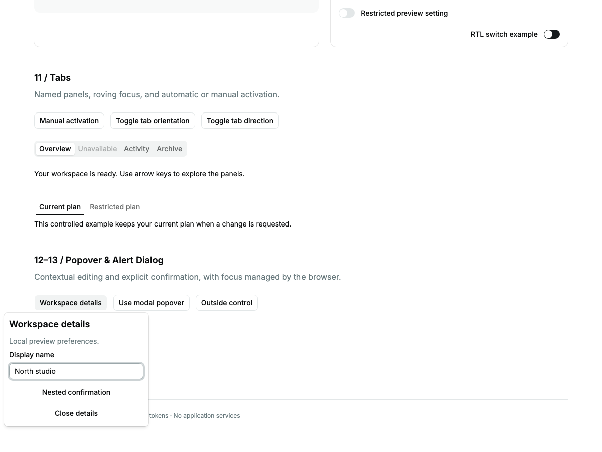
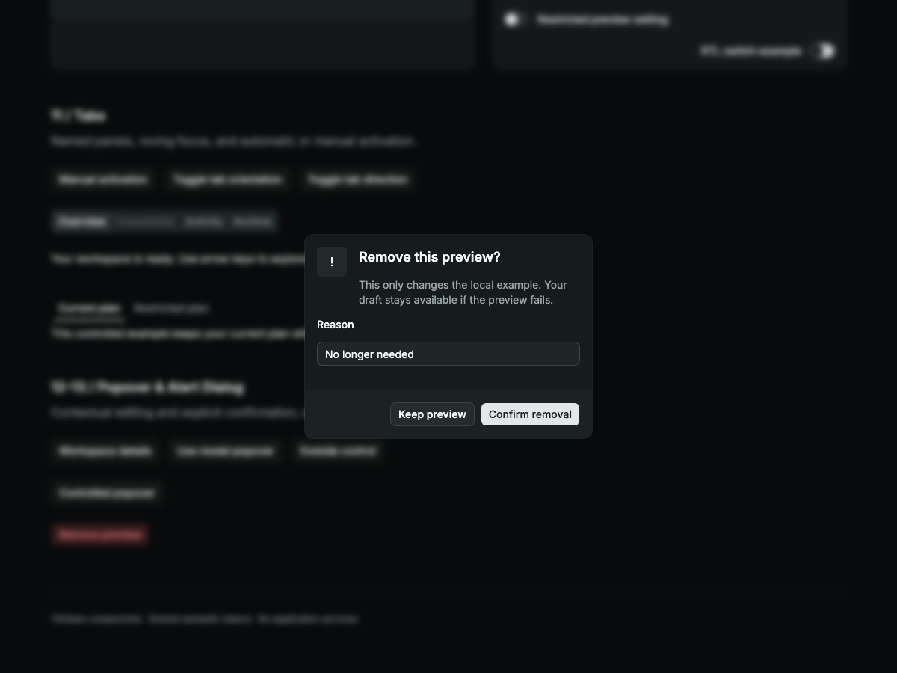
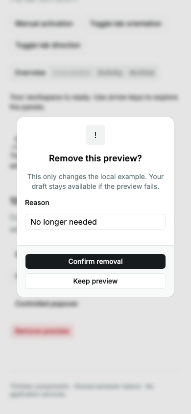

[WebKit coverage](WEBKIT-DELIVERY.md) uses WebKit 26.6 on macOS, with native
Option-Tab for links and process-scoped button keyboard navigation. A pointer
click need not focus a native button in WebKit; outside dismissal preserves that
browser behavior. Packaged Safari and iOS devices remain untested.

The new components require modern HTML popover/dialog APIs. Chromium, Firefox and WebKit
are tested; older browsers, hydration and physical assistive-technology
sessions are not certified by this batch. See [delivery evidence](../OVERLAYS-DELIVERY.md).

## Combobox

```tsx
import { createSignal } from 'solid-js';
import {
  Combobox, ComboboxInput, ComboboxContent, ComboboxList,
  ComboboxItem, ComboboxEmpty,
} from 'shadcn-solidjs-theme/ui/combobox';
import { Label } from 'shadcn-solidjs-theme/ui/label';

function FruitField() {
  const [fruit, setFruit] = createSignal<string | null>('Apple');
  return <>
    <Label for="fruit">Favorite fruit</Label>
    <Combobox items={['Apple', 'Banana', 'Cherry']} value={fruit()}
      onValueChange={next => setFruit(next)} name="fruit" required>
      <ComboboxInput id="fruit" showClear />
      <ComboboxContent>
        <ComboboxList>{(item: string) =>
          <ComboboxItem value={item}>{item}</ComboboxItem>
        }</ComboboxList>
        <ComboboxEmpty>No matches. Try another search.</ComboboxEmpty>
      </ComboboxContent>
    </Combobox>
  </>;
}
```

`items` is required. Strings work directly; objects require stable unique keys
with `itemToStringValue` and human-readable labels with `itemToStringLabel`.
Null represents no single selection. Empty string is a real item; a required
single-value form field rejects its empty serialized value, following HTML.
Do not use null/undefined as option values or duplicate keys.

`value`/`onValueChange` and `open`/`onOpenChange` are independently controlled.
Omit them to use `defaultValue` and `defaultOpen`. Defaults are read at mount;
reset returns to that baseline. A controlled owner can reject selection or
closure. Search is a draft: typing alone never changes the submitted value.
Selection, Escape, Tab and dismissal discard the uncontrolled search draft.
`inputValue`/`onInputValueChange` let the application own search; callback reasons
are `input-change`, `input-clear`, `item-select`, and `dismiss`. Input paste follows
the browser's input event and reports `input-change`.

Default filtering is a trimmed, case-insensitive label substring. `filteredItems`
bypasses it for application filtering or asynchronously supplied results. Keep
request cancellation, stale-result checks, pending/error presentation, and retry
in the application. Render loading/status/error content beside the list; show
ComboboxEmpty only when an empty result is ready. The library starts no requests,
submits no mutations, and performs no retries. Large lists are not virtualized.

`isItemDisabled` excludes options from keyboard selection and pointer activation.
Root `disabled` blocks editing and submission; `readOnly` blocks user changes
while retaining submitted values. `name`, `form`, and `required` configure a
visually hidden native select. Multiple values use repeated FormData entries.
For controlled forms, provide `defaultValue` as the reset baseline and accept
the reset request in `onValueChange` when the owner permits it.
The [form and ownership examples](../playground/combobox-contracts.tsx) run at
`/?combobox-contracts`; their [browser contracts](../tests/combobox-contracts.ts)
exercise both source and built exports in Chromium, Firefox and WebKit.
Rejected controlled changes preserve canonical values. Reset waits until the
browser finishes resetting fields, respects cancellation, and cancels pending
restoration on unmount. Invalid submission exposes a named error and opens the
chooser; use `aria-describedby` for additional help.

Arrow Up/Down open and navigate enabled choices with wrapping; Enter commits;
Escape cancels. Tab discards the draft after native focus navigation: from an
inline input it reaches the optional trigger, then the next control; Shift+Tab
reaches the preceding control. From popup search, Tab reaches the next outside
control and Shift+Tab returns to the trigger. Deferred closure is canceled on
unmount or a newer open/close request. Home/End retain native text-cursor behavior.
IME composition does not commit selections. Active options scroll inside the
list while DOM focus remains on the input. Scrolling accounts for the opening
scale animation. List/Collection render callbacks use layout-neutral presentation
wrappers to isolate reactive row reads; style options by their data-slot rather
than assuming they are direct DOM children of the list.
[Navigation acceptance](COMBOBOX-CMB2-DELIVERY.md) covers a 40-option list, native
Tab destinations and a chooser inside modal Popover. Physical IME remains unrun.
Use a Label or explicit aria-label;
ComboboxLabel is a **group** label, not a field label.

For the admin's popup-search pattern, place `ComboboxTrigger` outside Content,
and place `ComboboxInput showTrigger={false}` inside Content. The trigger opens
a named chooser dialog and focus enters its search field. Selection/Escape
return focus to the trigger. `ComboboxValue` displays the current canonical label
or its `placeholder`. Both editable-input and trigger-first examples are in the
live gallery. Content inherits Popover's placement/lifecycle props and theme
ancestry; it contains an explicitly named listbox.

For multiple selection use `multiple` and an array value. Compose
`ComboboxChips`, `ComboboxValue<string>` with a one-argument render callback,
`ComboboxChip value={item}`, and `ComboboxChipsInput`. Chips provide named remove
buttons (`showRemove={false}` hides one); multiple selection keeps the popup open.
`ComboboxClear` clears through the owner and supports a cancellable click handler.
The gallery demonstrates this complete composition.

Additional parts: `ComboboxGroup` (name it with aria-label/aria-labelledby),
`ComboboxLabel`, `ComboboxSeparator`, and `ComboboxCollection` for rendering the
filtered items inside manual group markup. A List render callback must declare
its item parameter; zero-argument functions are treated as Solid JSX. Manual
markup must represent the same options as the root's filtered collection.

Intentional differences from the React/Base UI sibling: Solid `class`, lowercase
native attributes, callback refs, and native Popover placement; no React ref
object `useComboboxAnchor`, custom anchor prop, arbitrary Base UI `render` prop,
virtualization, auto-highlight/auto-select, chip arrow-navigation, or exit-presence
animation is promised. Input/Content reuse existing token-based field/popover
styles instead of the sibling's unavailable InputGroup/Base UI internals. The
seven names currently imported by the React admin are present, but that inventory
check does not certify a port of the admin or every Base UI behavior.

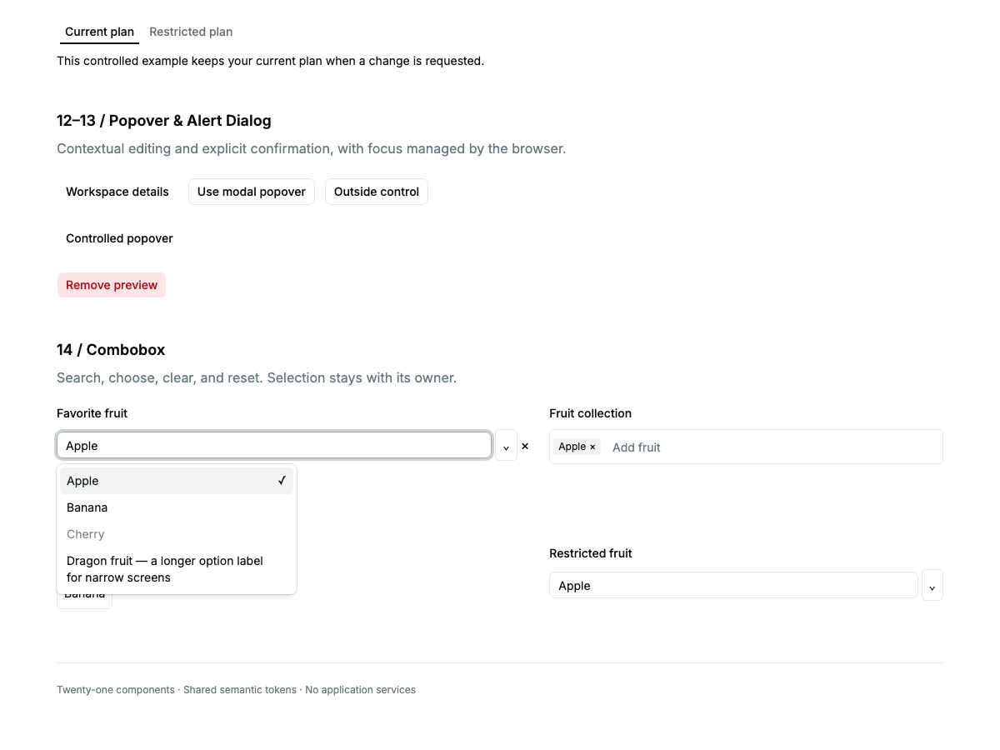
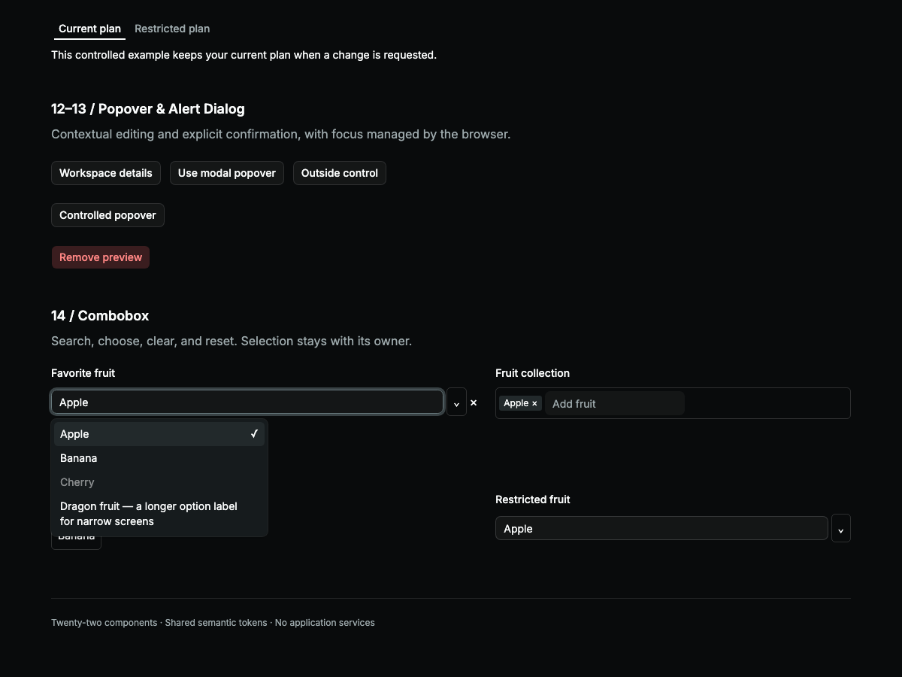
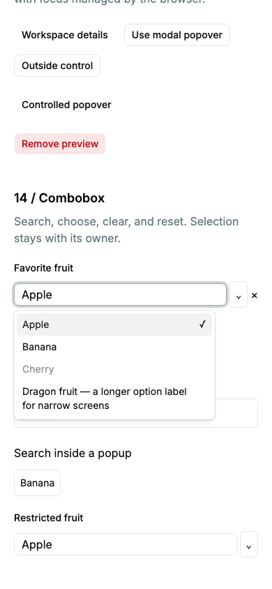

## Accordion and Collapsible

Open `/?disclosures` (or `/?disclosures&dark`) in the playground. Both components
use native buttons, owned Solid signals and the shared semantic theme. Kobalte
was evaluated first; [its diagnostic evidence](../KOBALTE-DISCLOSURES.md) explains
the current implementation choice.

```tsx
import { createSignal } from 'solid-js';
import { Accordion, AccordionItem, AccordionTrigger, AccordionContent }
  from 'shadcn-solidjs-theme/ui/accordion';
import { Collapsible, CollapsibleTrigger, CollapsibleContent }
  from 'shadcn-solidjs-theme/ui/collapsible';
import { buttonVariants } from 'shadcn-solidjs-theme/ui/button';
import { Input } from 'shadcn-solidjs-theme/ui/input';

function Details() {
  const [open, setOpen] = createSignal(false);
  return <>
    <Accordion type="single" defaultValue="profile" collapsible>
      <AccordionItem value="profile" triggerId="profile-question" contentId="profile-answer">
        <AccordionTrigger headingLevel={2}>Profile details</AccordionTrigger>
        <AccordionContent forceMount>
          <Input aria-label="Profile draft" defaultValue="My workspace" />
        </AccordionContent>
      </AccordionItem>
      <AccordionItem value="billing" disabled>
        <AccordionTrigger>Billing is unavailable</AccordionTrigger>
        <AccordionContent>Billing details</AccordionContent>
      </AccordionItem>
    </Accordion>
    <Collapsible open={open()} onOpenChange={setOpen}>
      <CollapsibleTrigger class={buttonVariants({ variant: 'outline' })}>
        Extra information
      </CollapsibleTrigger>
      <CollapsibleContent class="pt-3">Application-owned content.</CollapsibleContent>
    </Collapsible>
  </>;
}
```

| Part | Contract |
| --- | --- |
| Accordion | Required `type="single"` uses a string `value`/`defaultValue`/`onValueChange`; `type="multiple"` uses string arrays. Choose the type for the owner's lifetime. Single mode starts empty unless given a default; once open, `collapsible` allows clearing it. |
| Accordion root/item/trigger | Root and item accept `disabled`; the trigger also accepts native `disabled`. Items require unique, nonempty `value` strings. `orientation` defaults to vertical, `loop` defaults to true, and DOM `dir` controls horizontal arrow direction. |
| AccordionTrigger | Native button inside an accessible heading (default level 3; `headingLevel` accepts 2–6). Decorative chevron follows expansion. `class` styles the button; callback `ref` receives it. |
| AccordionContent | Named `region`; `class` styles the inner padded body. Other native attributes and `ref` reach the outer content element. |
| Collapsible | Boolean `open`/`defaultOpen`/`onOpenChange`, `disabled`, native root attributes. Controlled requests only change the display when the owner updates its prop. |
| CollapsibleTrigger/Content | Unstyled native button and content div; compose buttonVariants and content classes as needed. |
| IDs and mount policy | Set `triggerId`/`contentId` on AccordionItem or Collapsible, not on its parts. Defaults are stable generated IDs. Both are known at SSR time and update reactively. Content shells remain hidden while closed; children unmount unless Content has `forceMount`. |

Tab reaches each enabled trigger. Enter/Space toggles expansion. Accordion arrows
move focus without changing selection; Home/End reach the first/last enabled
trigger. Horizontal arrows follow LTR/RTL; `loop={false}` clamps at the ends.
Nested accordions/disclosures do not redirect navigation in the parent. A required
single selection uses `aria-disabled` while retaining focus so another question
can still be reached. Canceled `onClick`/`onKeyDown` handlers suppress the default
action. Triggers always use `type="button"`, including inside forms.

Use `forceMount` when local input drafts should survive closing. Hidden content is
removed from layout, accessibility navigation and Tab order; this applies even
when the shell has display utility classes. Ordinary content starts fresh on
reopen. No fetching, retry policy, persistence or application authorization lives
inside these components. Loading/error/empty content belongs to the application.

Differences from the React sibling: Solid `class` and callback refs, root/item ID
configuration, native trigger elements (no `asChild`), no height measurement CSS
variables, and no animated exit or delayed unmount. Accordion retains the sibling's
root/item/trigger/content classes apart from height-animation hooks; one decorative
native chevron rotates instead of importing the sibling's two React icons. Reduced motion removes the trigger
transition. Token overrides and light/dark/narrow layouts are verified; physical
screen-reader sessions, animation parity and every arbitrary nested composition
are not certified by automated tests.

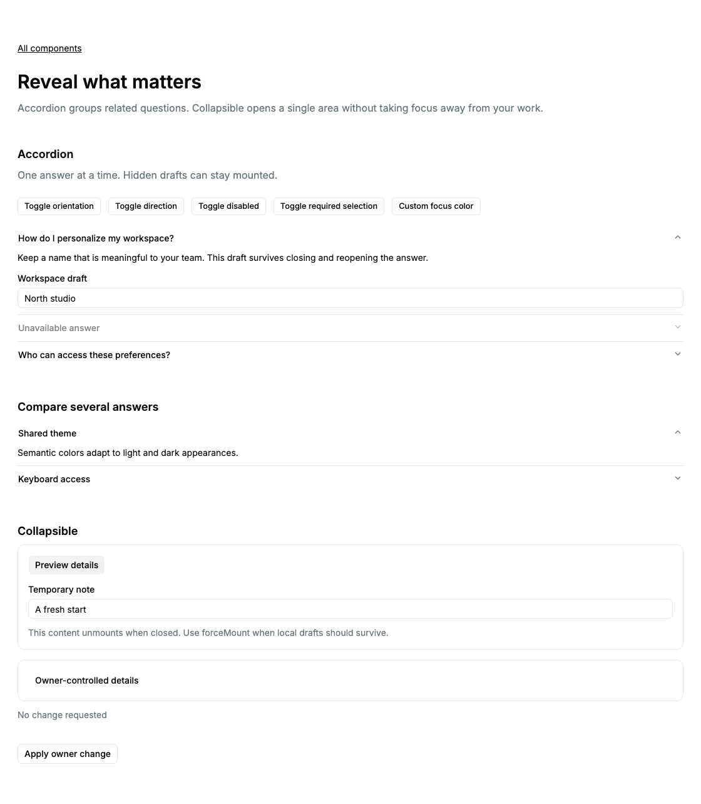
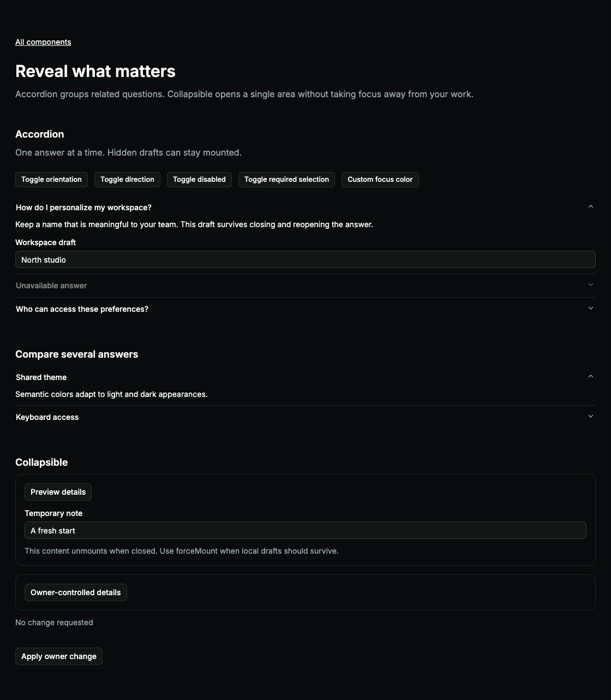
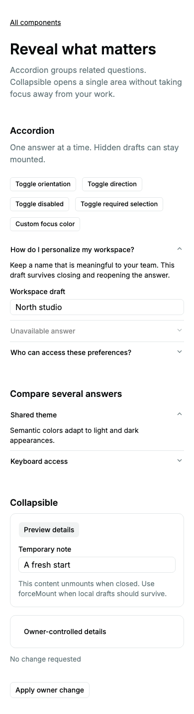

## Tooltip and Hover Card

Open `/?hints` (append `&dark`) for live examples. Tooltip adds a short,
noninteractive description to a button. Hover Card previews information behind a
native link; keep the destination usable without the preview. Use Popover or Dialog
for essential forms and actions. Tooltip content must not contain focusable controls.

```tsx
import { Tooltip, TooltipProvider, TooltipTrigger, TooltipContent }
  from 'shadcn-solidjs-theme/ui/tooltip';
import { HoverCard, HoverCardTrigger, HoverCardContent }
  from 'shadcn-solidjs-theme/ui/hover-card';
import { buttonVariants } from 'shadcn-solidjs-theme/ui/button';

function Previews() {
  return <>
    <TooltipProvider delayDuration={200} skipDelayDuration={300}>
      <Tooltip contentId="save-description">
        <TooltipTrigger class={buttonVariants({ variant: 'outline' })}>
          Save draft
        </TooltipTrigger>
        <TooltipContent side="bottom">Keep your work without publishing it.</TooltipContent>
      </Tooltip>
    </TooltipProvider>
    <HoverCard openDelay={500} closeDelay={300}>
      <HoverCardTrigger href="/team/maya" class="underline">Maya Chen</HoverCardTrigger>
      <HoverCardContent class="space-y-2">
        <p class="font-medium">Maya Chen · Design</p>
        <p>Creates welcoming spaces for your team.</p>
        <a href="/team/maya" class="underline">View profile</a>
      </HoverCardContent>
    </HoverCard>
  </>;
}
```

| Part | Public contract |
| --- | --- |
| TooltipProvider | Optional shared `delayDuration` (default 0), `skipDelayDuration` (300 ms), `disableHoverableContent` (false). A recently closed tooltip skips the hover delay within this provider. |
| Tooltip | Boolean `open`, `defaultOpen`, `onOpenChange`; `delayDuration` overrides provider hover delay. `closeDelay` defaults to 100 ms. `disabled` suppresses display/interaction while preserving owner selection. |
| HoverCard | Same boolean owner contract; `openDelay` defaults to 700 ms, `closeDelay` to 300 ms. Keyboard focus opens immediately. No provider is required. |
| Both roots | `contentId` sets a stable custom ID before SSR. IDs update reactively. Controlled callbacks request changes; rejected requests do not change the displayed canonical state. |
| TooltipTrigger | Native button, always type button. Native attributes/refs/events, root/native disabled state and existing aria-describedby are preserved. Open descriptions are appended without changing its name. Pointer down/click dismiss without consuming the button action. |
| HoverCardTrigger | Native anchor with href/target/rel/ref/events. Root disabled removes href, sets aria-disabled and removes it from Tab order. Open content is a supplemental description. Navigation remains native. |
| Both Content parts | `side`, `align`, `sideOffset`, `alignOffset`, `collisionPadding` (8), `avoidCollisions` (true), `forceMount`, `onEscapeKeyDown`, native div attributes/ref/style/class. Custom IDs belong on the root. Tooltip defaults top/center/6px; Hover Card bottom/center/4px. |

Hover starts a cancellable timer. Leaving before opening, disabling the root,
removing the trigger or disposing the root prevents a late open. Keyboard focus
opens immediately. Pointer travel inside the rectangle joining trigger and content
keeps the preview open, including a pause over the gap. Leaving both regions closes
after the delay, unless focus remains within them. TooltipProvider can disable
hoverable content. Touch pointer hover does not open previews; touch-device behavior
has not been manually certified.

Escape closes the top preview, leaves focus in place and does not close its parent
modal. `onEscapeKeyDown` can cancel that request. Outside pointer activation requests
closure without restoring focus. Hover Card allows native Tab travel into its links;
leaving both trigger and content closes it. Content uses bubbling `onFocusIn` and
`onFocusOut` for this contract. Canceled caller pointer/focus handlers suppress the
associated internal behavior. Tooltip focus is never moved into its description.

Native manual popovers render above clipping ancestors while retaining DOM order
and local theme tokens. Floating UI follows scrolling, resizing and anchor movement;
collision handling flips/shifts the preview and bounds it to available space while
respecting its CSS size limits. Caller class/style changes refresh placement. Stale
coordinate results cannot affect a closed or replaced preview. The component owns
no request, loading/error state, network retry or application authorization.

Content shells remain mounted but hidden while closed. Ordinary children unmount;
`forceMount` retains them. Root IDs and shell identity survive source hydration.
The same semantic colors and typography apply in light/dark mode; use class/style
or inherited tokens to customize them. The stylesheet explicitly scans shared
rendering helpers, so these styles also ship in the compiled package.

Intentional differences from the React wrappers: native button/anchor elements
(no asChild), root-owned IDs, browser top layer instead of a portal-container API,
no Tooltip arrow, no Radix transform-origin variables, and no exit/presence animation.
The styling keeps the sibling's core surfaces, spacing and type. A rectangular
pointer bridge is less precise than a polygon corridor. Drag-selection persistence,
external manual calls to hidePopover, arbitrary nesting with other libraries,
physical assistive technology and touch devices remain unverified. Do not use a
preview as the only way to reach important content.

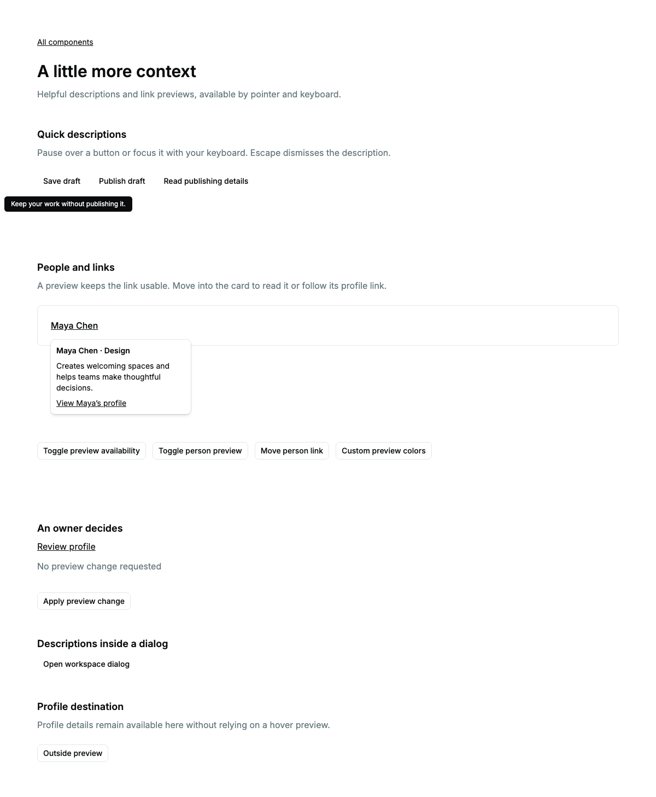
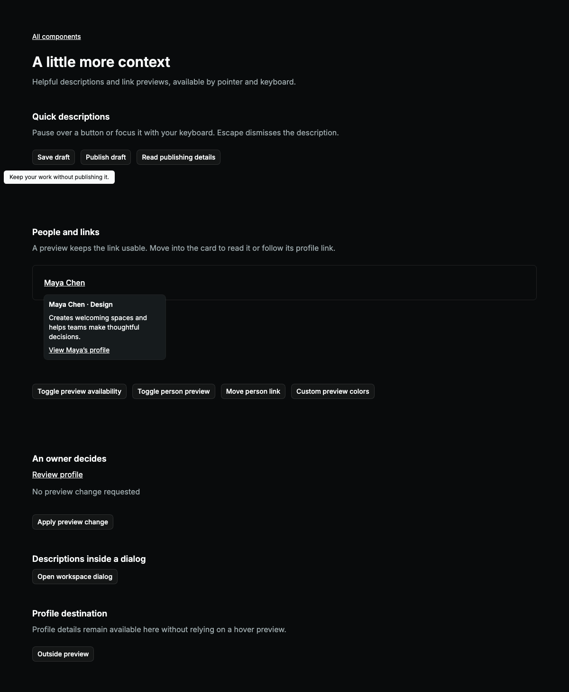
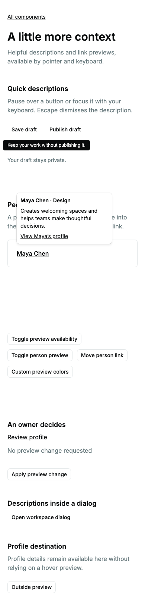

## Radio Group, Toggle and Toggle Group

Open `/?choices` (append `&dark`) for native radio forms, canceled resets, external
form ownership, controlled acceptance, pressed buttons and grouped focus.

```tsx
import { RadioGroup, RadioGroupItem } from 'shadcn-solidjs-theme/ui/radio-group';
import { Toggle } from 'shadcn-solidjs-theme/ui/toggle';
import { ToggleGroup, ToggleGroupItem } from 'shadcn-solidjs-theme/ui/toggle-group';

function Choices() {
  return <>
    <RadioGroup name="delivery" defaultValue="pickup" aria-label="Delivery method" required>
      <label><RadioGroupItem value="pickup" /> Collect in person</label>
      <label><RadioGroupItem value="shipping" /> Ship to my address</label>
    </RadioGroup>
    <Toggle aria-label="Bold" variant="outline">B</Toggle>
    <ToggleGroup type="multiple" defaultValue={['bold']} aria-label="Text styles">
      <ToggleGroupItem value="bold">Bold</ToggleGroupItem>
      <ToggleGroupItem value="italic">Italic</ToggleGroupItem>
    </ToggleGroup>
  </>;
}
```

| Component | Contract |
| --- | --- |
| RadioGroup | `value`, initial `defaultValue`, `onValueChange`; `name`, `form`, `required`, `disabled`, `readonly`; optional `orientation`, `loop` (true); native div attributes/ref/class/style. Supply a group name with aria-label or aria-labelledby. |
| RadioGroupItem | Required unique string `value`; native input attributes, `id`, ref, events, class, item disabled and aria-invalid. Wrap in a label or use Label with for/id. Group owns name/form/required/readonly/checked state. Ref targets the visible native radio. |
| Toggle | `pressed`, initial `defaultPressed`, `onPressedChange`; native button attributes/ref/events (onChange is reserved internally); `variant` default/outline, `size` sm/default/lg. Always type button. Exported `toggleVariants` provides the same style recipe. |
| ToggleGroup | Required `type` single/multiple; string or string-array `value`, `defaultValue`, `onValueChange` matching that type; disabled, orientation (horizontal), loop (true), rovingFocus (true), spacing (2), shared variant/size, native div attributes/ref/style/class. |
| ToggleGroupItem | Required unique string `value`; native button attributes/ref/events, item disabled, variant/size fallback when the root does not set them. Always type button; aria-pressed exposes state in both selection modes. |

All controlled callbacks request a change; the caller can reject it by retaining
its value. Native radio activation may temporarily uncheck the old input before
change fires, so the component restores every input to the canonical value after
the request. Uncontrolled state starts from the initial default. Use nonempty,
unique item values; an empty string represents no single selection. Changing a
ToggleGroup's selection type while mounted is outside the contract.

Radio Group uses real native inputs for labels, focus, required validation,
submission and reset. Only the selected enabled input is a successful control.
A generated name groups unnamed radios; set an explicit unique name for submitted
fields, and do not reuse it across independent groups in the same form. Root
disabled leaves the value intact. A missing/disabled selected item is not silently
replaced; the host decides the new value. Readonly prevents user changes but keeps
selection available to the form. Required does not force the owner to choose a value.

Reset requests the original default after every bubbling listener can cancel it.
Controlled rejection restores canonical inputs. The reset listener follows reactive
`form` changes; pending work is canceled on reassociation or unmount. A nonempty
unmatched form ID detaches the inputs; remove the prop to return to the enclosing
form. Firefox emits a native warning for an empty form attribute, so use an unmatched
ID for quiet detachment. Moving the root to a different form through external DOM
operations or replacing a form with another node of the same ID is not observed.

Radio arrows move focus and select, skipping disabled items. With no orientation,
both arrow axes work; horizontal follows inherited direction and vertical uses
Up/Down. Home/End target the first/last enabled item. Readonly arrows only move focus.
Toggle Group arrows/Home/End move focus without selecting; Space/Enter toggles the
focused button. Single selection can clear to an empty string; multiple selection
uses fresh arrays. Both use the current DOM order and ignore nested groups. A removed
item no longer owns a Tab stop, but restoring focus after removal of the actual
focused DOM node is not implemented. `rovingFocus={false}` gives each enabled grouped
button its ordinary Tab stop and disables group arrow handling.

Caller handlers run before internal behavior; preventDefault on click or keydown
cancels selection or navigation. Native focus/change events are normally not
cancelable; use click cancellation or controlled ownership to reject a change.
Kobalte Toggle ignores click cancellation internally, so this package
supplies controlled state and rejects that library request in its adapter. No
headless internals are exposed or patched. Toggle and Toggle Group are action-state
buttons, not successful form controls; form reset does not reset their pressed state.
Use Checkbox or Radio Group when native submitted selection is required.

The shared semantic tokens, outline/default variants, three sizes and joined group
borders match the sibling's core presentation. Spacing is in theme spacing units;
zero joins adjacent borders. Logical start/end edges support RTL, and a long group
can scroll within its available width. Classes and style override defaults;
custom color examples preserve light/dark contrast. Reduced motion removes pressed
button transitions. Input indicators are decorative; selection remains available
through native/ARIA checked or pressed state. Custom invalid styling requires
aria-invalid on the affected item.

SSR and source hydration cover native values and original element reuse. No asChild,
polymorphic rendering, toolbar-specific radio behavior, drag interaction, automatic
focus recovery after removal, dynamic root type switching, or app data layer is
provided. Physical assistive-technology sessions, touch devices, arbitrary
cross-library composition and published/streaming SSR remain unverified.

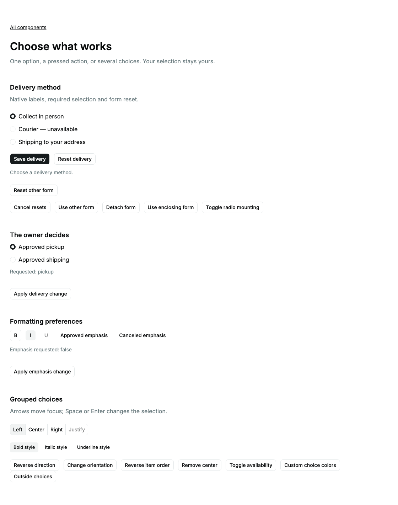
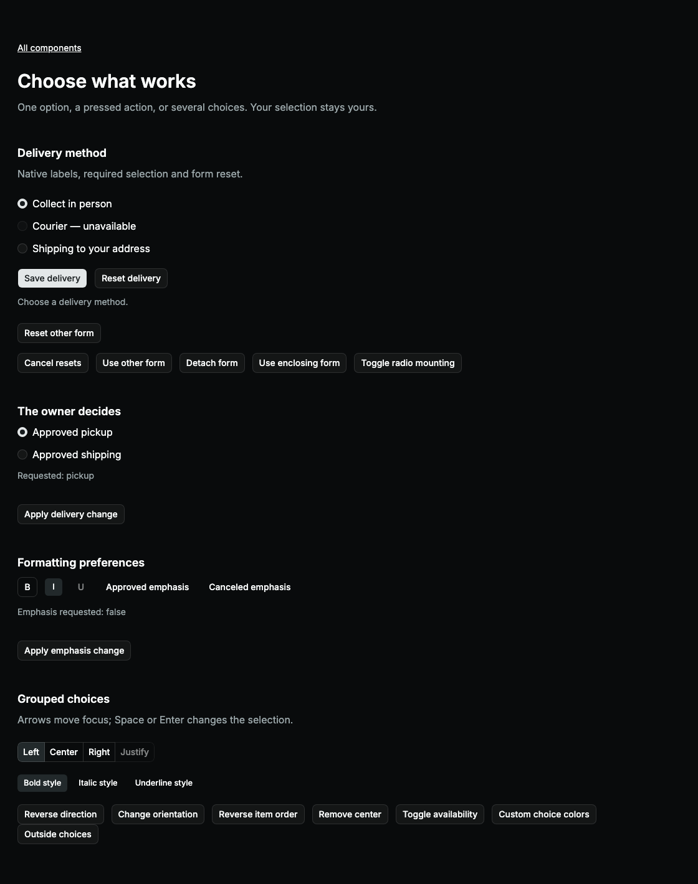
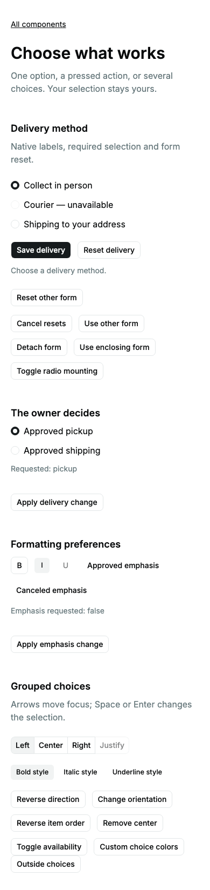

## Select

Open `/?select` (append `&dark`) for required/native forms, controlled acceptance,
long choices, custom colors and a Select inside a modal.

```tsx
import { Select, SelectTrigger, SelectValue, SelectContent, SelectItem } from 'shadcn-solidjs-theme/ui/select';

const fruit = [
  { value: 'apple', label: 'Apple' },
  { value: 'banana', label: 'Banana', disabled: true },
  { value: 'cherry', label: 'Cherry' },
];

<Select items={fruit} name="fruit" defaultValue="apple" required>
  <SelectTrigger aria-label="Fruit"><SelectValue placeholder="Choose fruit" /></SelectTrigger>
  <SelectContent>{item => <SelectItem value={item.value} />}</SelectContent>
</Select>
```

| Part | Contract |
| --- | --- |
| Select | Required `items: readonly SelectOption[]` with unique nonempty string values and plain-text labels; optional item disabled. `value`/`defaultValue`/`onValueChange`, independently controlled `open`/`defaultOpen`/`onOpenChange`, `name`, `form`, `required`, `disabled`, `readOnly`. No wrapper element. |
| SelectTrigger | Native button attributes/ref/events/class; size `default` (32px) or `sm` (28px). Always type button with combobox semantics. Supply aria-label or an external Label linked to its id. |
| SelectValue | Label from root item data; placeholder for the empty string. Native span props, class and optional custom children. |
| SelectContent | Native div props/ref/class; side top/bottom, align start/center/end, sideOffset 4, collisionPadding 8. Accepts composed children or the per-item render function shown above. |
| SelectItem | Required matching value, native div props/events/class and optional custom children. Label, disabled state and canonical selection come from root data. |
| SelectGroup / SelectLabel | Compose a named group. Include one SelectLabel inside each group; its generated ID connects the label. A label outside a group is plain visual text. |
| SelectSeparator | Decorative separator between groups. |
| SelectScrollUpButton / SelectScrollDownButton | Click scrolls 100 CSS pixels without moving trigger focus. Content includes both automatically; native button props, label, children and class may customize explicitly composed copies. |

The explicit item array supplies labels and native options during closed SSR,
without discovering child registrations after hydration. Render each item once in
that data order, including every enabled option. Use Content's per-item render
function for large lists: its row scopes avoid Solid's wide-dependency diagnostic.
For grouped composition, render matching SelectItems inside SelectGroups. Values
must be unique and nonempty; empty string means no selection. Missing selected data
retains the value and shows its string until the owner supplies another value.

Controlled callbacks request changes; retaining a prop rejects the request. Selection
and popup visibility may be accepted independently. Disabled and readOnly block user
changes; disabled also excludes the native control from FormData. A hidden native
select owns submission and required validity. Invalid submission focuses the visible
trigger and exposes aria-invalid. Provide adjacent error/help text and aria-describedby
for application-specific validation messages. Reset requests the original default
after bubbling cancellation, follows reactive form ownership, and cancels pending
work on reassociation/disposal. Use an unmatched nonempty form ID to detach; removing
the prop restores the enclosing form. External DOM relocation/form-node replacement
is not observed. A disabled selected native option is not a successful form value.

Arrows open and navigate, wrapping enabled options; Home/End move within the open
list; Enter/Space commit; Escape closes without committing. Closed typeahead selects,
open typeahead highlights; repeated letters cycle and a 700ms pause clears the buffer.
Tab leaves the trigger for the browser's ordinary destination. Focus stays on the
trigger while aria-activedescendant exposes the active option. Caller click/keydown
handlers run first and preventDefault cancels internal action. Items keep focus on
the trigger during pointer selection. Controlled dismissal rejection leaves visibility
under owner control; the popup is nonmodal and never traps focus.

The manual browser popover stays in theme ancestry and escapes clipping. Floating UI
tracks movement, scrolling and resize, flips/limits the popup, and ignores stale
position results after changes/disposal. The bounded list scrolls active options into
view after resizing. Semantic tokens, class/style overrides, light/dark, RTL and
reduced-motion behavior are tested. Scroll arrows remain visible at list boundaries;
hover/hold auto-scroll is not implemented. This is a flat single-select API; no
multiselect, editable search, item-aligned Radix positioning, portal/asChild API or
virtualized list is provided. Use Combobox for editable search.

Source SSR/hydration, source/built browser interaction and light/dark/mobile visuals
are covered in the [Select delivery](SELECT-DELIVERY.md). Physical assistive technology,
touch, published/streaming SSR and application integration remain unverified.

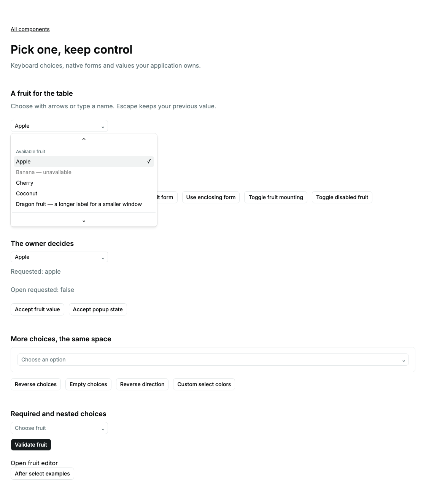
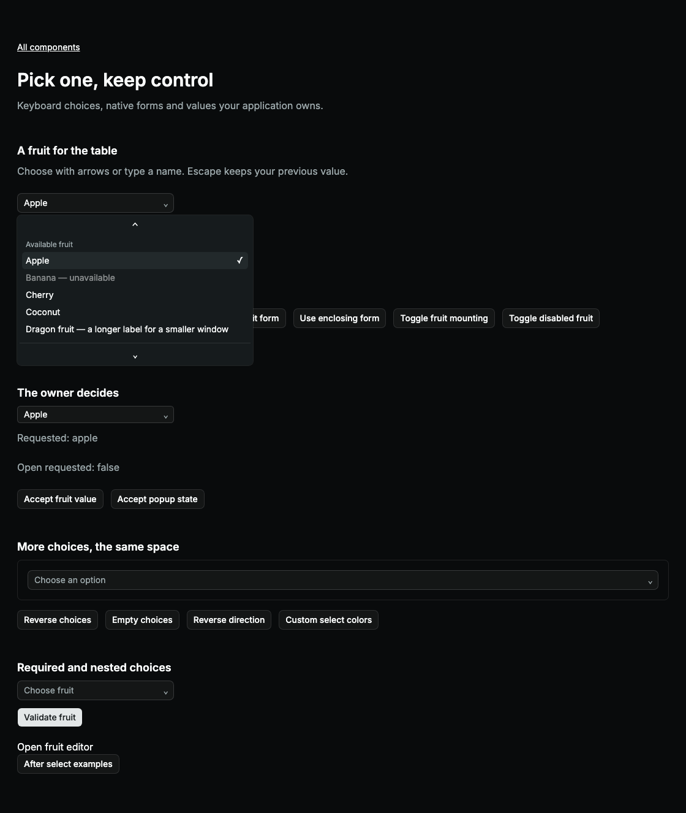
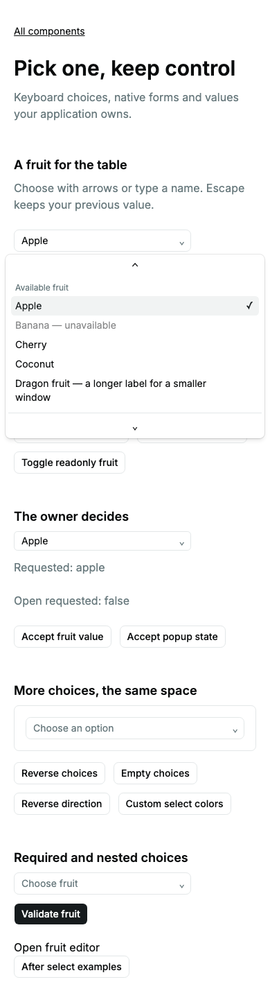

## Slider

Open `/?slider` (append `&dark`) for range forms, owner acceptance, decimal steps,
RTL, inversion, vertical sliders and disabled/readOnly states.

```tsx
import { createSignal } from 'solid-js';
import { Slider } from 'shadcn-solidjs-theme/ui/slider';

function PriceRange() {
  const [range, setRange] = createSignal([20, 80]);
  return <Slider value={range()} onValueChange={setRange}
    min={0} max={100} step={1} minStepsBetweenThumbs={10}
    name="price" aria-label="Price range" thumbLabels={['Minimum price', 'Maximum price']}
    getValueText={value => `${value} dollars`} />;
}
```

| Prop | Contract |
| --- | --- |
| value / defaultValue | Number arrays for controlled or local values. Default is `[min, max]`; use `[value]` for a single thumb. An empty array intentionally renders no thumbs. |
| onValueChange | Requests a fresh sorted array during keyboard/pointer adjustment or an accepted reset. Retaining a controlled prop rejects the request. |
| onValueCommit | Reports the accepted normalized array once after pointer release, keyup or focusout if the gesture changed it. Runs after Solid's batch; no callback for rejection, canceled gestures, reset or disposal. |
| min / max / step | Defaults 0 / 100 / 1. Finite ordered bounds and a positive finite step; the step grid must fit safe integer precision. Values are snapped to the grid from min and clamped. If max is off-grid, the highest reachable value is the last grid point below it. |
| minStepsBetweenThumbs | Nonnegative integer, default 0. Gap in step units. Invalid configuration or insufficient room throws RangeError; an application may recover with an Errored boundary or correct its props. |
| orientation / inverted | Horizontal (default) or vertical; inverted defaults false. Inherited RTL is read at interaction time and respected by logical positioning. |
| disabled / readOnly | Disabled removes thumbs from Tab order and form submission; readOnly retains both but prevents user changes. |
| name / form | Hidden native inputs share the same name, one per thumb. Use FormData.getAll(name) to obtain their values. Reactive form ownership and default reset are supported. |
| thumbLabels / getValueText | Unique accessible labels per thumb and optional human-readable value text `(value, index) => string`. Otherwise the root aria-label/labelledby is inherited. Explicit thumb labels override shared labelledby. |
| Native div props | Root id/ref, class/style, direction, ARIA attributes and events are forwarded. No children, polymorphism or compound-part API in this wrapper. |

The root is a named group and each thumb is a native button with slider semantics.
Supply an accessible root name and distinguish range thumbs with thumbLabels.
aria-describedby/aria-invalid pass to thumbs; application error/help content stays
outside the component. No required option is provided: a nonempty range always has
numeric values, and business validation belongs to the form owner. Reusing name
submits repeated values without adding brackets automatically.

Each thumb remains the same DOM node when its numeric value changes. Values are
sorted, snapped and constrained as derived data without mutating the input array.
A thumb cannot cross its neighbors. Controlled out-of-range data is displayed and
submitted in normalized form, but the parent array itself is unchanged. Avoid
extreme floating-point magnitudes that cannot represent your desired resolution.
Empty data, fixed min=max and dynamic bounds are explicit supported states.

Arrows adjust one step. Shift+Arrow and PageUp/PageDown adjust ten; Home/End reach
the thumb's allowed neighbor-constrained bounds. Horizontal Left/Right follows RTL
and inversion; Up/Down follows inversion. Page keys retain numeric increase/decrease.
Tab uses normal DOM order. A track press picks the nearest thumb (ties retain the
focused thumb); dragging captures the pointer until release, so it works beyond the
track bounds. Current geometry is measured on every move. A zero-size track cannot
start or update a gesture.

Caller pointerdown/move or keydown handlers run first; preventDefault cancels that
change. Canceling pointerup, keyup or focusout suppresses the commit callback while
retaining already accepted live values. Pointer cancellation or capture loss also
retains live values without committing. Disabled/readOnly, axis/bounds/step/gap or
thumb-count changes cancel an active gesture; unmount releases capture and blocks
queued commits. No network write or automatic retry is owned by Slider.

Reset restores the initially captured defaults after all bubbling listeners can
cancel it. Controlled owners may reject reset. Pending resets are canceled when
form ownership changes or the Slider is disposed. Use an unmatched nonempty form
ID to detach; remove form to return to the enclosing form. External DOM relocation
or replacing a form node with another of the same ID is not observed.

The sibling's thin track and small circular thumb are retained, with semantic
primary/muted/ring/background tokens, enlarged pointer targets, custom class/style,
light/dark themes and reduced motion. Vertical defaults to 160px tall; override
height on the root. Keep room around track endpoints for the centered thumbs.
There is no crossing/swap mode, draggable filled range, per-thumb disabled state,
marks/ticks, tooltip, wheel gesture or application persistence. Physical touch and
assistive-technology sessions, published/streaming SSR, native forced-colors mode,
focus recovery after removing the focused thumb and application/Electron integration
remain unverified. See [delivery](SLIDER-DELIVERY.md) for exact acceptance evidence.

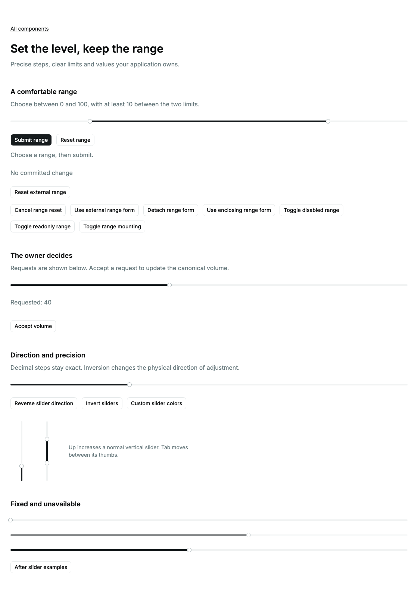
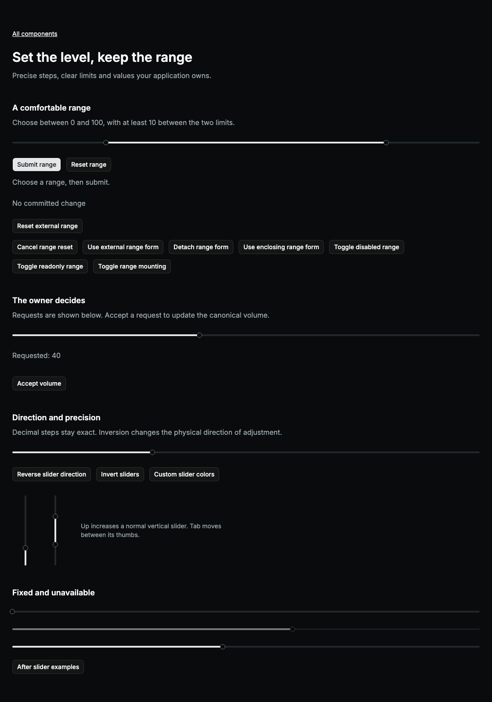
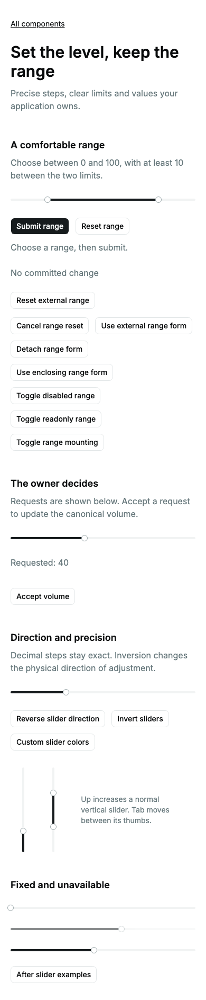

## Acceptance evidence

See the [per-component test matrix](TEST-MATRIX.md) for linked assertions,
SSR/visual scope, and open acceptance gaps for every implemented family.
