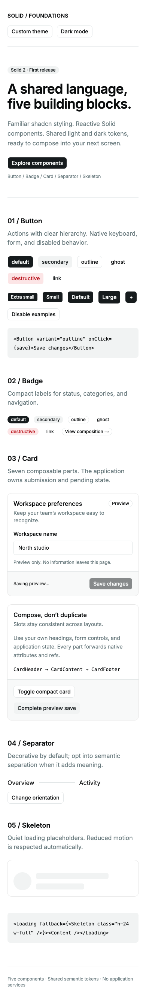

# Foundation component guide

All components forward native attributes, events, children and refs. Use `class`
for caller overrides. Import only from `shadcn-solidjs-theme`; dependencies stay
inside the package (D19). The live playground demonstrates each component.

## Button

```tsx
import { createSignal } from 'solid-js';
import { Button } from 'shadcn-solidjs-theme/ui/button';

function SaveAction() {
  const [pending, setPending] = createSignal(false);
  return <Button disabled={pending()} aria-busy={pending() ? 'true' : 'false'}
    onClick={() => setPending(true)}>{pending() ? 'Saving…' : 'Save'}</Button>;
}
```

Variants: `default`, `outline`, `secondary`, `ghost`, `destructive`, `link`.
Sizes: `default`, `xs`, `sm`, `lg`, `icon`, `icon-xs`, `icon-sm`, `icon-lg`.
Icon-only controls need an accessible name, e.g. `aria-label="Add item"`.
The app owns pending state, errors and retries; Button never fetches or starts a
mutation itself. Native buttons support Enter/Space and disabled semantics.

```tsx
<Button as="a" href="/settings" variant="outline">Settings</Button>
<Button type="submit" form="preferences">Save preferences</Button>
<Button size="icon" aria-label="Add item">+</Button>
```

Disabled anchors lose href, leave the tab sequence, expose aria-disabled, and
block click handlers. `as` accepts `button` or `a`; custom router links can use
`class={buttonVariants({variant: 'outline'})}` and own navigation semantics.

## Badge

```tsx
<Badge variant="secondary">Ready</Badge>
<Badge variant="destructive">Needs attention</Badge>
<Badge as="a" href="#details" variant="outline">Details</Badge>
```

Uses a span by default, without an invented interactive role. The same six
variants are available. Status meaning must include text, not color alone.

## Card

```tsx
<Card size="sm">
  <CardHeader>
    <CardTitle><h2>Team preferences</h2></CardTitle>
    <CardDescription>Settings shared with your team.</CardDescription>
    <CardAction><Badge variant="outline">Preview</Badge></CardAction>
  </CardHeader>
  <CardContent>Your controls go here.</CardContent>
  <CardFooter><Button>Save changes</Button></CardFooter>
</Card>
```

Card has `size="default" | "sm"`; its six child parts are native divs. Supply a
heading at the appropriate document level inside CardTitle. No implicit section,
landmark or heading level is imposed. Use `class="min-w-0 break-words"` on content
that may contain long unbroken identifiers.

## Separator

```tsx
<Separator />
<Separator decorative={false} />
<div class="flex h-8 items-center gap-4">
  Overview <Separator orientation="vertical" class="h-6" /> Activity
</div>
```

Default decorative separators are hidden from assistive technology. Meaningful
separators use `decorative={false}`, expose `role="separator"` and the correct
aria-orientation. Both orientation and decorative state can be reactive.

## Skeleton

```tsx
import { Loading } from 'solid-js';
<Loading fallback={
  <div aria-busy="true">
    <span role="status">Loading profile…</span>
    <Skeleton class="h-12 w-12 rounded-full" />
    <Skeleton class="mt-3 h-4 w-48" />
  </div>
}>
  <Profile />
</Loading>
```

Skeleton is a decorative div; size it with utilities. Its animation stops under
`prefers-reduced-motion: reduce`. The application controls readiness and supplies
status text, recovery, and eventual content. A real async Loading boundary is
covered by the unit suite.

## Themes and screenshots

Import `theme.css` once. Add `.dark` to an ancestor for dark mode. Override semantic
variables on a containing element to customize a region:

```tsx
<div style={{'--primary': 'oklch(0.46 0.15 155)',
  '--primary-foreground': 'oklch(0.99 0 0)', '--radius': '0.8rem'}}>
  <Button>Custom brand</Button>
</div>
```

Keep foreground/background pairs accessible when overriding tokens. The default
destructive emphasis token mixes destructive with foreground for stronger small
text contrast; `:root`/`.dark` values still match the sibling React theme exactly.
These are reviewed Solid gallery baselines, not pixel comparisons against React.



