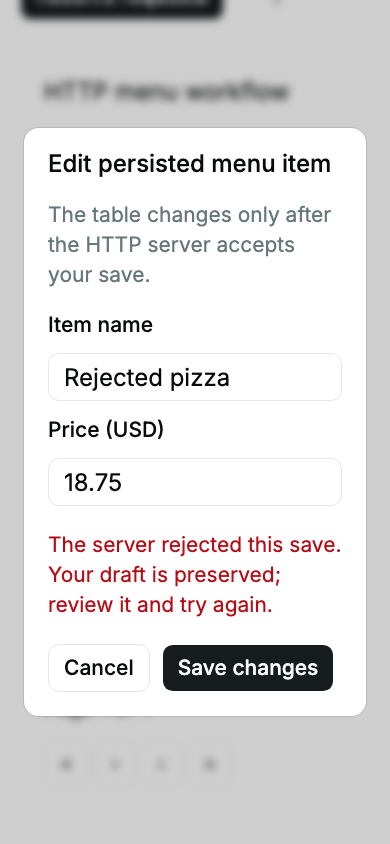
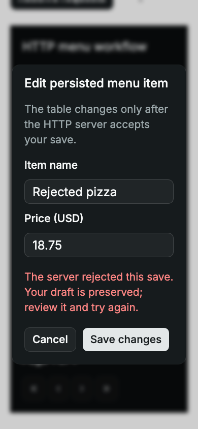

# HTTP consumer workflow — 2026-10-20

The isolated Solid Router/Query consumer now validates Data Table → edit Dialog
→ HTTP save/error recovery through public component exports. This supplies
controlled HTTP/cache composition evidence for ALL-5. It does not migrate or
certify an existing production application: the backend is a loopback,
in-memory Vite test service with a separate session per browser case.

## Findings and behavior

The first accepted-save case failed: the server and Edit button had the new
name, but the table still displayed the original name and price. Query rc.5
reconciles stable store proxies, while Table core caches accessor values by row
identity. The consumer now derives tracked plain row snapshots before passing
data to the table. Stable row IDs preserve selection and focus. The test checks
both displayed cells and the server record; the original failure is retained
in [browser evidence](../evidence/consumer-workflow-browser.json).

Six new scenarios cover accepted canonical names/integer prices, route-cache
reuse and full-reload persistence; explicit rejection/retry in both themes;
a held write with disabled controls, canceled Escape and duplicate submit
attempts; an accepted write with an unreadable acknowledgement; and a second
HTTP client's conflicting version. Unknown outcomes never trigger automatic
writes and remain blocked across route remounts. Reload reads the canonical
server record. The cache and mutation policy are application-owned.

Both source and freshly rebuilt ESM component modes run all nine consumer
scenarios in Chromium, Firefox and WebKit: 27 checks per mode. The consumer
application itself runs in Vite in both modes. There are no fetch mocks, new
primitive implementations, runtime dependency changes, or diagnostic suppressions.
Domain rejections use a typed HTTP 200 envelope; this does not establish handling
of arbitrary backend status codes, outages or network partitions.

The narrow rejection states were visually inspected at 390px with 24px text in
light and dark themes. Labels, fields, recovery text and actions remain readable;
axe and document-width assertions pass. These are evidence screenshots, not
new visual regression baselines:

## Verification

Commands and whole-command wall times are retained in
[command evidence](../evidence/consumer-workflow-checks.json). Browser suites ran
sequentially on `THEME_PORT=4403`, with one worker, no retries and unchanged
strict browser diagnostics. The development preview on 4399 was not used.

| Command | Result | Time |
| --- | --- | ---: |
| `THEME_PORT=4403 RESULTS_FILE=/tmp/consumer-workflow-source-final.json bun run test:consumer --max-failures=1` | 27 passed | 29.467 s |
| `Programmatic ESLint recommended rules on the four new consumer files (see JSON)` | Isolated consumer ESLint passed (exact invocation in JSON) | 0.743 s |
| `THEME_PORT=4403 CONSUMER_BUILT=1 RESULTS_FILE=/tmp/consumer-workflow-built.json bun run test:consumer --max-failures=1` | 27 passed | 33.810 s |
| `THEME_PORT=4403 RESULTS_FILE=/tmp/consumer-workflow-focused-integration.json bunx --no-install playwright test tests/integration/admin-menu.spec.ts tests/integration/catalog-data-table.spec.ts --max-failures=1` | 36 passed | 67.626 s |
| `bun run check && bun run lint && bun run test && bun run test:server && node scripts/check-consumer.mjs && bun run docs:check && bun run parity:admin` | 406 unit + 26 SSR tests; root/consumer types, lint, examples and import parity passed | 22.290 s |
| `THEME_PORT=4403 THEME_PRODUCTION=1 RESULTS_FILE=/tmp/consumer-workflow-focused-e2e.json bunx --no-install playwright test tests/e2e/admin-menu.spec.ts tests/e2e/catalog-data-table.spec.ts --max-failures=1` | 36 passed | 60.945 s |
| `THEME_PORT=4403 RESULTS_FILE=/tmp/consumer-workflow-otp-baseline.json bunx --no-install playwright test tests/integration/catalog-dates.spec.ts --project=chromium --grep "OTP uses native text editing" --max-failures=1` | 1 passed; isolated comparison only | 2.947 s |
| `THEME_PORT=4403 RESULTS_FILE=/tmp/consumer-workflow-otp-current.json bunx --no-install playwright test tests/integration/catalog-dates.spec.ts --project=chromium --grep "OTP uses native text editing" --max-failures=1` | 1 passed; isolated comparison only | 4.101 s |

The first sandboxed browser launch could not bind the loopback port; the
network-enabled run supplied the required local server access. Initial Vite
config extension warnings were corrected by making server-module imports explicit.
The initial stale-cell failure was corrected at the consumer adapter boundary.

The first intended focused integration command used `bun run test:integration`
with file arguments. That script already supplies `tests/integration`, so
Playwright selected all 750 cases. It stopped after 32 passes on an unchanged
OTP pointer-caret assertion (expected position 1, received 6); 717 cases did not
run. Corrected direct Playwright file selection then passed all 36 relevant
admin/table cases. The OTP case passed in isolation both in an archive of unchanged
`origin/main` (`93422ef`) and on this branch, with the same dependencies and budgets.
Its broad-run cause remains undiagnosed; no OTP implementation/test was changed.
This report does not claim the full source integration suite passed. The failed
broad run and isolated comparisons remain in the evidence; this is an unrelated
intermittent finding, not a workflow regression repair.

Full coverage, full hydration, full built-library, public-site and manual
assistive-technology/device suites were not rerun for this client-only fixture.
Library runtime source is unchanged; SSR/hydration changes are N/A. Relevant
source/built Data Table and admin regressions were run separately. No production
performance benchmark, authentication, real database, or external app integration
was attempted. No registry publication, deployment or main merge is included.

## DELIVERY checklist

| Criterion | Evidence and applicability |
| --- | --- |
| State ownership | Confirmed rows live in the QueryClient, drafts in a field store, and open/pending/error states separately. The adapter derives immutable table input. |
| Usable states | Loading boundary, ready table, pending disabled form and explicit rejection/unknown/conflict feedback are implemented. Table filtering has its existing empty state; load outage handling is outside these assertions. |
| Recovery | Rejected drafts survive until explicit retry; server-confirmed values reach rows only on acceptance. Unreadable acknowledgements block replay until a full reload reads confirmed data. |
| Async consistency | A synchronous request guard and held-response test prove one write despite extra submit events. Disposal aborts the active fetch and ignores late settlement; a held-write disposal test is not included. |
| Platform boundaries | HTTP and cache ownership remain in validation/consumer-stack. Test service code stays in Vite server configuration and is not imported into browser/library source. Privileged APIs and production backends are N/A. |
| Reactivity/cleanup | Query-to-Table snapshots repair stale cached accessors. The consumer aborts on disposal and Query subscriptions follow their owners; diagnostic fixtures stay enabled. |
| Keyboard/access | Enter opens; item name receives focus; pending Escape cannot dismiss; focus returns to the current row action. Light/dark rejection states pass axe at enlarged mobile text. Manual AT is unrun. |
| Appearance | Semantic tokens and native modal ancestry are preserved; screenshots were inspected in both themes without clipping at 390px/24px text. Exhaustive variants and physical devices remain unrun. |
| Structure/performance | Contract, HTTP server, consumer UI and assertions are separate; no application policy enters component rendering. Two records are sufficient for the workflow, not a large-data benchmark. |
| Tests | Static/root unit/server gates, isolated consumer typecheck/lint, source/built three-engine HTTP workflows, and existing admin/table browser regressions supply the stated evidence. Remaining checks are disclosed above. |
| Delivery evidence | Exact commands/timings, initial failure, independent unrelated finding, screenshots, acceptance matrix, public guidance and lasting adapter decision are recorded. |

## Remaining adoption boundary

ALL-5 stays open for a real application's authentication, API contract,
persistence, uncertain-write policy and representative data volume. This fixture
establishes a reproducible HTTP integration pattern and the cache-to-table adapter
needed for the pinned stack; it does not certify production application adoption.
